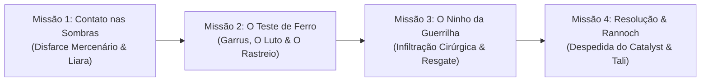

# Mass Effect: Consciência e Carne *(Ghost in the Flesh)*
### Bíblia de Produção, Guia Narrativo & Estrutura de Desenvolvimento

> **Linha de Base Canônica:** Meses após o desfecho **Control (Paragon)** de *Mass Effect 3*.  
> **Protagonista:** John Shepard (Infiltrator / Earthborn / War Hero de Elysium / Paragon Convicto).  
> **Romance:** Tali'Zorah vas Normandy.  
> **Metodologia de Escrita:** Método Floco de Neve (*Snowflake Method*).  

---

## 🧭 1. Visão Geral & Premissa Central

### 🌌 Logline
> *Renascido em carne mortal dentro do coração de um Reaper e desprovido de qualquer implante cibernético, John Shepard descobre que células de guerrilha da Cerberus sequestraram o Almirantado Quariano para doutrinar seus líderes e, através deles, subjugar a frota desmilitarizada dos Geth. Ciente de que sua identidade pública resultaria na execução imediata de Tali por vingança, Shepard precisa agir nas sombras: une-se a Liara e a Garrus — que caça a Cerberus para afogar o luto pelo amigo — combinando a inteligência da Shadow Broker e as migalhas digitais de Tali para desarticular a guerrilha antes que a frágil paz galáctica desmorone.*

### 🧬 O Motivo Condutor: A Terceira Chance
1. **1ª Chance (O Fuzileiro):** O herói mortal da Aliança e sobrevivente implacável da Blitz de Elysium.
2. **2ª Chance (A Arma Cibernética):** O soldado reconstruído a titânio e circuitos pela Cerberus no Projeto Lazarus.
3. **3ª Chance (O Homem Livre):** Carne 100% orgânica e vulnerável, livre de coleiras cibernéticas ou deuses cósmicos, conquistando o direito a uma vida mortal finita.

---

## ⚖️ 2. A Origem, o Catalyst & O Imperativo do Sigilo

### 🩸 O Despertar na Câmara do Reaper
* **A Biologia Acelerada do Thorian & A Câmara Pressurizada:** A reconstrução celular de John em poucos meses só foi possível pela combinação dos registros moleculares do Lazarus com a síntese de biomassa acelerada do **Thorian** (Feros). Como o interior de naves Reapers é composto de maquinário sem atmosfera padrão para orgânicos, o Catalyst adaptou uma **câmara estéril de biogestação selada com suporte de vida e atmosfera pressurizada** de oxigênio/nitrogênio para a maturação do novo corpo humano.
* **O Choque Biológico:** A transição é brutal. A sobrecarga de dor, frio, gravidade e ardor respiratório faz seu novo corpo colapsar. Ele desmaia sobre as ligas metálicas escuras da câmara.
* **A Consciência Plena & A Honestidade do Catalyst Paragon:** O Catalyst — moldado pela essência moral e ética do sacrifício Paragon de Shepard — **não mente**. Ele informa com clareza límpida que o corpo original foi atomizado no Crucible e esta é uma manifestação biológica pura, sem implantes. Shepard tem ciência de sua mortalidade desde o primeiro respiro; seu foco absoluto é a urgência inegociável de salvar Tali.
* **Biometria & Digitais Distintas (Citadel DLC):** Como cânone na Citadel DLC, as impressões digitais de John não coincidem com os registros da Aliança ou da C-Sec. Vantagem tática contra scanners automáticos de estações e o peso existencial de seu apagamento formal na burocracia galáctica.
* **O Diálogo dos Dois Shepards:** Ao recobrar a consciência, John está nu no chão frio diante de uma projeção holográfica de si mesmo gerada pelo Catalyst.
* **A Impossibilidade de Resgate pelos Reapers:**
  * Os Reapers têm poder de fogo apocalíptico, mas **zero histórico ou capacidade de operações furtivas**. Em uma crise com reféns em ambiente confinado, qualquer abordagem de naves capitais causaria o extermínio imediato dos prisioneiros.
  * Além disso, a galáxia inteira ainda vive sob o trauma da invasão. O deslocamento de Reapers em direção a sistemas habitados causaria histeria em massa e o colapso da frágil diplomacia pós-guerra.
* **As Simulações de Vingança da Cerberus:** O Catalyst alerta que a Cerberus executará Tali sumariamente caso saiba que Shepard sobreviveu, por pura retaliação vingativa. John deve ser um fantasma total.
* **O Ponto de Partida:** O Catalyst disponibiliza um traje civil com blindagem mercenária sem identificação, um capacete com visor polarizado e modulador vocal eletrônico, e as credenciais de um cargueiro civil descaracterizado.

---

## 🏛️ 3. Cenário Geopolítico & A Trama da Cerberus

### A Nova Galáxia & A Adaptação dos Geth
* **Paz e Reconstrução:** A cura do Genophage deu voz aos Krogan. Em Rannoch, Quarians e Geth deram início à coexistência pacífica.
* **Geth Desmilitarizados:** Para viabilizar a aceitação política na comunidade galáctica e dissipar o pavor histórico das espécies do Conselho, os Geth passaram por um rigoroso processo de **desmilitarização**. Suas plataformas agora atuam na reconstrução civil, arquitetura e engenharia agrícola, enquanto a sociedade Quariana ainda aprende a viver lado a lado com suas antigas criações.

### O Modus Operandi da Cerberus: Células de Guerrilha
* A Cerberus não é mais um império corporativo com frotas visíveis. São **células terroristas de guerrilha clandestina**, fragmentadas e entrincheiradas nos confins dos Sistemas Terminus. 
* **O Desafio da Localização:** A galáxia inteira está no escuro. Ninguém sabe onde o transporte diplomático está escondido. Uma intervenção militar convencional é impossível porque não há alvo conhecido para as frotas da Aliança atacarem.

### O Plano de Doutrinação Indireta & O Segredo da Citadel
* **A Lição do Homem Ilusório:** No final de Mass Effect 3, a Cerberus estudou intensamente métodos de replicar a doutrinação.
* **A Testemunha Solitária da Galáxia:** Apenas **John Shepard** sabe com certeza absoluta que a Cerberus obteve sucesso em controlar a mente e o sistema nervoso de seres vivos. Na sala do controle da Citadel, ele sentiu o Homem Ilusório paralisar seu corpo e forçá-lo a atirar no Almirante Anderson. Anderson e o Homem Ilusório morreram ali; para o Conselho e a Aliança, a Cerberus foi apenas um grupo extremista derrotado com pesquisas bizarras. Shepard é o único ser vivo que conhece o terror real e funcional dessa arma.
* **O Alvo São os Quarians:** A célula de guerrilha herdou os protocolos do Homem Ilusório e pretende **doutrinar o Almirantado Quariano (liderado por Tali)**. Como os Geth desmilitarizados têm confiança cega em seus Criadores e acatam suas diretrizes, controlar os Quarians significa controlar indiretamente a rede sintética.
* **A Missão de Erradicação:** Além de salvar Tali e o Almirantado, Shepard assume para si o dever moral de **destruir e purgar permanentemente cada protótipo, servidor, algoritmo e resquício dessa tecnologia de controle mental**, garantindo que a herança maldita do Homem Ilusório seja varrida da galáxia para sempre.

### A Resistência de Tali (As "Migalhas de Pão")
* Tali'Zorah resiste bravamente ao confinamento e aos procedimentos iniciais de manipulação mental. Usando componentes ocultos de sua armadura e comandos de contingência quarianos, ela atrasa os experimentos e dispersa micro-pulsos de dados criptografados — "migalhas de pão" na extranet que apenas sensores avançados conseguem interceptar.

---

## 🗺️ 4. Estrutura Narrativa: O Arco das Quatro Missões



### Missão 1: Contato nas Sombras (Liara T'Soni)
* **Objetivo:** Estabelecer canal seguro com a Shadow Broker no cinturão de radiação.
* **O Disfarce & O Choque:** Shepard chega no cargueiro civil sob a persona de um mercenário mascarado. Trancado a sós no santuário privado de Liara, ele remove o capacete e desliga o modulador, gerando choque e perplexidade imediata na Asari.
* **A Conexão (*Embrace the Eternity*):** Liara conecta sua mente à de John e encontra a mente humana pura do velho amigo, intacta e livre de controle Reaper.
* **O Rastreamento Inicial:** Liara intercepta os primeiros micro-pulsos codificados por Tali, mas a área de dispersão nos Terminus é vasta demais para uma localização exata. Eles precisam de inteligência de campo tática.

### Missão 2: O Teste de Ferro (Garrus Vakarian & A Caçada ao Luto)
* **O Estado de Garrus:** Após a guerra, Garrus recusou o descanso burocrático e assumiu o comando de uma força-tarefa especial de caça a células remanescentes da Cerberus. Seu motivo secreto: **ele caça os extremistas para afogar a dor e o vazio pelo amigo que morreu**.
* **O Encontro & A Prova Pragmática:** Shepard localiza Garrus em um posto avançado. Garrus reage armado, mas a camaradagem de trincheira, os erros de tiro memoráveis e o pragmatismo militar de dois veteranos de C-Sec prevalecem.
* **A Cruzada de Inteligência:** Garrus possui registros de rotas de suprimentos e movimentações das células que estava caçando. Quando Liara sobrepõe os dados de campo de Garrus às migalhas digitais de Tali, o enigma se resolve: **eles descobrem o esconderijo exato da guerrilha**.
* **A Nave de Garrus:** A equipe embarca na corveta furtiva de operações especiais da força-tarefa de Garrus, pronta para inserção silenciosa.

### Missão 3: Operação Resgate — O Ninho da Guerrilha
* **Objetivo:** Infiltração cirúrgica nas instalações clandestinas da Cerberus nos Terminus, impedindo a doutrinação de Tali e do Almirantado, e resgatando os diplomatas e os nós de processamento civis Geth.
* **Atmosfera:** *Black-Ops Stealth* analógico e tenso (dupla de veteranos de C-Sec e infiltração clássica N7).
* **A Dinâmica Operacional:**
  * **Garrus:** Posicionado em ponto alto, fornecendo cobertura silenciosa e antecipando as rotas da guerrilha.
  * **Liara:** Suporte cibernético e biótico, neutralizando alarmes e contramedidas eletrônicas da base.
  * **Shepard (Infiltrator Analógico):** Avanço furtivo, neutralizações manuais, operando a Black Widow mecânica no ritmo puro do controle respiratório.
* **A Queda da Célula:** Shepard neutraliza o comandante da Cerberus antes que o processo de lavagem cerebral atinja o córtex de Tali. Os diplomatas e os módulos Geth desmilitarizados são evacuados em segurança para a nave de Garrus.
* **O Sigilo Perante o Almirantado:** Durante toda a extração, Shepard mantém a blindagem mercenária e o capacete com visor polarizado e modulador ligados na frente dos demais membros do Almirantado Quariano. Ninguém, exceto Tali em momento isolado, descobre a identidade do salvador mascarado.
* **O Relatório Oficial:** O crédito oficial pela erradicação da célula da Cerberus e resgate dos líderes de Rannoch é atribuído à **Força-Tarefa de Garrus Vakarian com suporte de inteligência da Shadow Broker**. Shepard permanece um fantasma nos registros históricos, permitindo seu descanso definitivo.

### Missão 4: O Desfecho & O Encontro com Tali
* **O Adeus Indiferente do Catalyst:** Com a rede segura e o equilíbrio protegido, o comunicador emite as palavras finais: *"Parâmetros operacionais atendidos. O canal de telemetria será desativado permanentemente. A anomalia encerrou sua função. Viva o tempo que lhe resta, John."* Uma sobrecarga térmica consome o circuito. John está livre de qualquer amarra.
* **A Dúvida Exclusiva de Tali:** O impacto emocional do luto rompido é preservado para ela. Shepard se despe da blindagem e mostra a respiração pesada, os batimentos cardíacos acelerados e o terror palpável de quase tê-la perdido.
* **A Confirmação Biológica no Penhasco de Rannoch:**
  * Diante das fundações da casa sob o sol de Rannoch, Tali desacopla o capacete ao ar livre.
  * Eles se beijam. O sistema imune dela reconhece quimicamente o microbioma único de John (adaptado em ME3): nenhuma reação alérgica, febre ou choque. Prova biológica incontestável de que aquele homem é o seu John.
  * Inicia-se a Terceira Chance — a vida simples, mortal e plena conquistada com sangue e coragem.

---

## ❄️ 5. Metodologia: Método Floco de Neve (*Snowflake Method*)

```
Passo 1: Logline & Frase Central (Concluído)
   ↓
Passo 2: Parágrafo Geral & As 4 Missões (Concluído e Refinado)
   ↓
Passo 3: Fichas de Personagens, Vozes e Motivações (Concluído)
   ↓
Passo 4: Sinopse Expandida de Cada Bloco Narrativo (Concluído)
   ↓
Passo 5: Escalação de Cenas do Capítulo 1 (A seguir)
   ↓
Passo 6: Redação Integral da Prosa e Diálogos
```