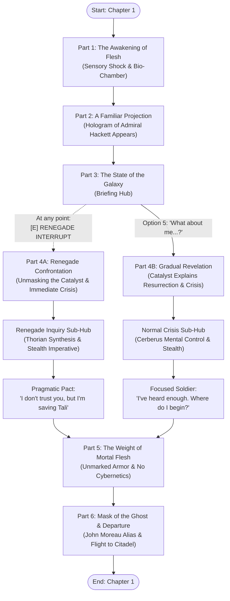

# Chapter 1: A Third Chance *(A Terceira Chance)*
### Narrative Script & Scene Architecture (Visual Novel Engine)

> **Setting:** Interior of a Reaper Bio-Gestation Vessel (Pressurized and Sterile Incubation Chamber).  
> **Protagonist:** Commander John Shepard (First-person POV; newly synthesised 100% organic human body).  
> **Characters Present:** Admiral Steven Hackett / The Catalyst (Holographic Projection) — `assets/portraits/hackett.png`.  
> **Timeline:** Two months after the *Control (Paragon)* outcome of *Mass Effect 3*.  
> **Narrative Reference:** Aligns with [`docs/planejamento.md`](../planejamento.md) (The Awakening & The Origin) and the engine code in [`data/chapters/1.a-third-chance/`](../../data/chapters/1.a-third-chance/).

---

## 📖 Resumo Geral do Capítulo (Executive Narrative Summary)

Dois meses após o sacrifício de John Shepard no ápice do Crucible, o lendário comandante desperta desprovido de qualquer implante cibernético no convés congelado de uma câmara de biogestação pressurizada no coração de uma nave Reaper.

* **Ato 1: O Despertar da Carne (Nudez e Frio):**
  - Shepard é expelido de uma placenta bio-orgânica com lodo amarelado e tosse o primeiro oxigênio real em seus pulmões puramente humanos.
  - Ele percebe que seu corpo não possui as próteses e circuitos do Projeto Lazarus: não há titânio, nem olhos cibernéticos brilhantes, apenas pele pálida e vulnerável. Ao redor, cabos sintéticos estão fundidos a nódulos do Thorian.
* **Ato 2: A Projeção Familiar (A Voz de Hackett):**
  - Um feixe de luz ciano projeta a figura solene do Almirante Steven Hackett em uniforme de gala. O suposto Almirante ordena que Shepard respire com calma e o ajuda a estabilizar as funções motoras após o choque sináptico.
* **Ato 3: O Briefing da Galáxia (Hub de Informações):**
  - Hackett informa que a guerra acabou e a galáxia está sendo reconstruída.
  - Através de um menu de diálogo completo (estilo RPG/Baldur's Gate), o jogador pode investigar o papel construtivo dos Reapers, a desmilitarização voluntária dos Geth em Rannoch, o controle dos clãs Krogan sob Wrex e Bakara, e a reativação dos Mass Relays.
* **A Grande Bifurcação (Renegade vs. Revelação Gradual):**
  - **Ramo Renegade ([E] Interrupt):** A qualquer instante do briefing, o jogador pode desmascarar a farsa: Shepard percebe que o verdadeiro Hackett jamais estaria a sós no ventre de um Reaper. O Catalyst abandona a encenação militar e elogia os reflexos analíticos de John, revelando imediatamente a crise brutal: **Tali'Zorah vas Normandy e o Almirantado Quariano foram sequestrados por uma célula terrorista da Cerberus**, que pretende usar tecnologia de controle neural para subjugar os Geth através dos Quarians. Shepard aceita um pacto pragmático apenas para salvá-la.
  - **Ramo Normal (Investigação Completa):** Ao esgotar as perguntas e indagar sobre sua própria ressurreição, a projeção assume sua voz polifônica. O Catalyst explica que utilizou a biomassa acelerada do Thorian combinada com a matriz celular do Lazarus e o mapa neural de Shepard gravado no Crucible. Ele revela o rapto de Tali e a necessidade urgente de um operador invisível para resgatá-la sem atrair a retaliação da Cerberus.
* **Ato 5: O Peso da Carne Mortal (Equipamentos Sem Implantes):**
  - Um pedestal revela blindagem de combate sem identificação, sua pistola pesada M-3 Predator e um capacete com visor polarizado e modulador de voz.
  - O Catalyst lembra que Shepard é agora 100% mortal: sem escudos, qualquer disparo de fuzil causará hemorragia e morte. O jogador reage à sua nova fragilidade biológica.
* **Ato 6: A Nova Identidade & Partida:**
  - O console registra uma credencial mercenária sob o nome falso de *John Moreau* (homenageando Joker), com digitais não catalogadas que facilitam a passagem por scanners.
  - O Catalyst fornece as coordenadas da Citadel e aponta a Shadow Broker (Liara T'Soni) como o primeiro contato obrigatório. Shepard fecha o capacete, ativa o modulador e embarca no cargueiro civil ruma à Citadel.

---

## 🗺️ Chapter Architecture & Flowchart

---

## 🎬 Part 1: The Awakening of Flesh (`1.despertar-carne.js`)

### Scene Summary
* **Location:** `assets/backgrounds/reaper_chamber.jpg`
* **Characters Present:** Shepard (POV).

### Narrative Concept & Dramatic Focus
The scene opens in complete darkness. Shepard's consciousness surfaces through viscous, suffocating cold. His final memory was the agonizing incinerating heat of the Crucible consuming his bones and vaporizing his cybernetics.

* **The Physical Shock:**
  - Shepard is expelled from an amniotic membrane, dropping onto the frozen metal alloy floor of a bio-gestation chamber.
  - Coughing violently, he expels yellowish fluid from his lungs; the first intake of pressurized oxygen burns his trachea like crushed glass.
  - His limbs feel dead and atrophied. Looking at his pale, trembling hands, he realizes the scars and glowing cybernetic subdermal channels of the Lazarus Project are gone. He is purely biological human flesh.
* **The Environment:**
  - Behind him, the pod reveals an unsettling fusion: pulsating gray Thorian tendrils and biomass intertwined with hexagonal synth-cables and Reaper antimatter conduits.
  - Subsonic vibrations through the deck plates confirm the unthinkable: he is inside an active Reaper capital ship.

---

## 🎬 Part 2: A Familiar Projection (`2.projecao-familiar.js`)

### Scene Summary
* **Location:** `assets/backgrounds/reaper_chamber.jpg`
* **Characters Present:** Shepard (POV), Admiral Steven Hackett (Holographic Projection).

### Narrative Concept & Dramatic Focus
A cyan laser beam projects a life-sized holographic image of **Admiral Steven Hackett** in pristine Alliance dress uniform. 

* **The Staged Comfort:**
  - Hackett orders Shepard to stand and regulate his breathing, explaining that his nervous system just rebooted from catastrophic synaptic shock.
  - Disoriented and overwhelmed by seeing his supreme commander, Shepard attempts to rise, collapsing to one knee.
  - The Admiral assures him that the war is over, the Reapers have stood down, and Earth has been spared. Hackett instructs Shepard to listen to a strategic briefing on the state of the galaxy.

---

## 🎬 Part 3: The State of the Galaxy - Briefing Hub (`3.briefing-galaxia.js`)

### Scene Summary
* **Location:** `assets/backgrounds/reaper_chamber.jpg`
* **Characters Present:** Shepard (POV), Admiral Steven Hackett (Holographic Projection).

### Narrative Concept & Interactive Mechanics
Hackett assumes his trademark command posture, reporting on the post-Crucible galaxy across two months of peace.

* **The Constant Renegade Prompt:**
  - Throughout this entire briefing hub, the **[E] Renegade Interrupt** prompt remains persistently available.
  - Activating `[E]` immediately cuts Hackett off, bypassing the remaining briefing and jumping directly to the **Renegade Confrontation Branch (Part 4A)**.

* **Baldur's Gate Style Investigation Choices:**
  1. *"What is the Reapers' role now? How did galactic civilization not collapse in panic?"*  
     *(Hackett explains that Reapers are acting as heavy reconstruction platforms under new directives, repairing orbital infrastructure and clearing fallout under Council surveillance).*
  2. *"How is Rannoch? Did the peace between the Quarians and the Geth endure?"*  
     *(Hackett notes that peace is flourishing; the Geth voluntarily demilitarized all platforms to ease organic fears, dedicating their processing power to agriculture, civil engineering, and environmental scrubbing).*
  3. *"Did the Genophage cure remain stable among the Krogans?"*  
     *(Hackett confirms that Urdnot Wrex and Bakara maintain order; expansion is being directed diplomatically toward newly chartered garden worlds).*
  4. *"What about the damaged Mass Relays? Did the Leviathans show themselves?"*  
     *(Hackett reports that roughly a quarter of the relay network is already repaired, and the Leviathans remain silent in their deep-sea trenches).*
  5. *"What about me, Admiral? How am I breathing... and what am I doing inside a Reaper?"*  
     *(Unlocks after exploring the previous topics; concludes the briefing and transitions peacefully to the Normal Revelation Branch, Part 4B).*

---

## 🎬 Part 4A: Renegade Confrontation (`4a.renegade-desmascaramento.js`)

### Scene Summary
* **Location:** `assets/backgrounds/reaper_chamber.jpg`
* **Characters Present:** Shepard (POV), The Catalyst (Holographic Hackett avatar).

### Narrative Concept & Dramatic Climax
Triggered by the `[E]` Renegade Interrupt. Shepard's tactical combat instincts flag the absurdity of Admiral Hackett delivering a solo diplomatic briefing inside an alien dreadnought while Shepard lies naked and weaponless on the deck.

* **The Shattered Simulation:**
  - Shepard cuts him off sharply, demanding the imposter drop the act.
  - Hackett's human warmth dissolves instantly. His eyes flash brilliant crystalline cyan, and an analytical smile touches his lips.
  - The entity introduces itself: **The Catalyst**, the directing intelligence Shepard took control of at the Crucible. It commends Shepard for detecting the environmental anomalies four minutes ahead of statistical models.
* **The Immediate Crisis:**
  - The Catalyst bluntly reveals the truth: **Tali'Zorah vas Normandy and the Quarian Admiralty were abducted in the Terminus Systems by an underground Cerberus guerrilla cell**.
  - Cerberus intends to deploy the Illusive Man's neural indoctrination protocols on Tali and the admirals, using their authority to indirectly enslave the demilitarized Geth.
* **Renegade Sub-Investigation Menu:**
  1. *"How am I breathing if my body was incinerated on the Crucible?"*  
     *(The Catalyst explains accelerated Thorian biomass synthesis combined with Lazarus Project molecular templates. Shepard's neural map was imprinted cleanly; he is 100% organic, unaugmented, and free).*
  2. *"Why don't you destroy their base yourself with the Reaper fleet?"*  
     *(Capital ship intervention guarantees hostage execution before touchdown. Furthermore, if Cerberus discovers Shepard survived, they will execute Tali immediately out of spite).*
  3. *"I don't trust a single word out of you. But I'm cooperating... strictly for Tali."*  
     *(The Catalyst accepts the pragmatic terms and directs Shepard to contact the Shadow Broker on the Citadel. Advances to Part 5).*

---

## 🎬 Part 4B: Gradual Revelation (`4b.revelacao-gradual.js`)

### Scene Summary
* **Location:** `assets/backgrounds/reaper_chamber.jpg`
* **Characters Present:** Shepard (POV), The Catalyst (Holographic Hackett avatar).

### Narrative Concept & Dramatic Focus
Triggered by selecting Option 5 after exploring the briefing topics. Shepard calmly asks Hackett how he survived the Crucible and why he was kept inside a Reaper.

* **The Serene Truth:**
  - The holographic projection's posture relaxes; its cadence becomes polyphonic and serene.
  - The Catalyst explains that adopting Admiral Hackett's likeness was a psychological protocol to ground Shepard's waking organic mind and prevent dissociative panic.
  - It confirms Shepard's biological rebirth via Thorian biomass synthesis and the Lazarus matrix.
* **The Reason for Resurrection:**
  - The Catalyst explains that two weeks ago, Tali'Zorah vas Normandy was kidnapped by Cerberus remnants seeking to control the Geth through the Admiralty.
* **Normal Crisis Sub-Investigation Menu:**
  1. *"Who took Tali? What do they want with her?"*  
     *(Details the Cerberus guerrilla network and their pursuit of neural control technology).*
  2. *"Why hasn't the Alliance or the Reaper fleet intervened?"*  
     *(Explains that orbital assault would result in summary hostage executions, and Shepard's public survival would prompt immediate retaliatory murder).*
  3. *"I've heard enough. I won't let Cerberus touch her. Where do I start?"*  
     *(The Catalyst directs Shepard to Dr. Liara T'Soni on the Citadel, noting that Liara has the surveillance decryption necessary to decode Tali's emergency signals. Advances to Part 5).*

---

## 🎬 Part 5: The Weight of Mortal Flesh (`5.peso-carne-mortal.js`)

### Scene Summary
* **Location:** `assets/backgrounds/reaper_chamber.jpg`
* **Characters Present:** Shepard (POV), The Catalyst (Holographic Hackett avatar).

### Narrative Concept & Existential Weight
A hexagonal console rises from the deck, offering sterile, unmarked tactical equipment:
- An unmarked mercenary combat suit without N7 or Alliance insignia.
- A standard M-3 Predator heavy pistol, fully loaded.
- A sealed combat helmet with a polarized mirror visor and electronic voice modulator.

* **The Reality of Mortality:**
  - Shepard dons the armor plates. His newly grown muscles burn with lactic acid; his joints ache, and the plates feel twice as heavy.
  - The Catalyst delivers a stark warning: **Shepard possesses zero cybernetics.** No titanium-laced bones, no subdermal mesh, no Lazarus synthetic enhancements. A single high-caliber bullet without kinetic barrier shields will cause fatal hemorrhage.
* **Player Choice (Reaction to Mortality):**
  1. *"[Grip the pistol tightly.] Flesh and bone will be enough. I broke Saren as a mortal; I can tear Cerberus apart without implants."* (Paragon / Pure Determination)
  2. *"[Inspect the composite plates.] No titanium reinforcement or biotic mesh. One mistake and I bleed to death like any raw recruit."* (Renegade / Tactical Pragmatism)
  3. *"[Take a deep, clear breath.] After years of feeling like a Cerberus machine... it feels damn good to be purely human again."* (Reflective / Humanist)

---

## 🎬 Part 6: Mask of the Ghost & Departure (`6.mascara-partida.js`)

### Scene Summary
* **Location:** `assets/backgrounds/reaper_chamber.jpg`
* **Characters Present:** Shepard (POV), The Catalyst (Holographic Hackett avatar).

### Narrative Concept & The Final Leap
* **The Forged Biometrics:**
  - Shepard places his palm on the console laser scanner.
  - Because his newly synthesized dermal ridges and biometrics do not match Alliance records, the Catalyst registers a clean Terminus salvage contractor identity under the pseudonym **John Moreau** (a private homage to Joker).
* **Departure Tactical Hub:**
  - Before boarding, Shepard can inquire about Liara's current status on the Citadel, the dispersal of his old Normandy crew, and the reliability of his forged credentials.
* **The Helmet & The Vow:**
  - Shepard locks the heavy helmet onto his collar seals (`*pssshhht*`). The polarized visor turns opaque, and the voice modulator activates with a cold, metallic rasp.
  - The Catalyst provides docking coordinates for the rebuilt Citadel, where an unflagged long-range civilian shuttle waits in the ventral bay.
  - The holographic projection of Admiral Hackett snaps a crisp, respectful military salute. Shepard returns it by pure muscle-memory reflex.
  - The hologram fades into cyan light. The colossal Reaper hangar doors slide open to the silence of open space.
  - Shepard whispers his final promise into the sealed visor:
    - *"Hang on, Tali. I'm coming for you."*

---

## 🛠️ Implementation Reference (`data/chapters/1.a-third-chance/`)

This chapter is fully implemented and playable in the Visual Novel engine across seven modular JavaScript ES modules:

1. `1.despertar-carne.js` — Cold awakening, amniotic fluid shock, Thorian biomass realization.
2. `2.projecao-familiar.js` — Hackett holographic projection appears, motor stabilization.
3. `3.briefing-galaxia.js` — Galaxy briefing hub with persistent `[E]` Renegade Interrupt.
4. `4a.renegade-desmascaramento.js` — Renegade confrontation, simulation broken, Tali crisis urgency.
5. `4b.revelacao-gradual.js` — Normal revelation, Catalyst explanation, Tali abduction details.
6. `5.peso-carne-mortal.js` — Equipping unmarked gear, realization of fragile mortal organic flesh.
7. `6.mascara-partida.js` — Forged John Moreau credentials, departure questions, helmet seal, flight to Citadel.
8. `index.js` — Consolidates all nodes into `chapter01` and registers with `data/stories.js`.
