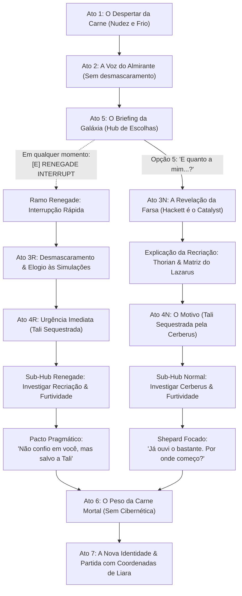

# Capítulo 1: A Terceira Chance *(A Third Chance)*
### Roteiro Narrativo & Estrutura de Diálogo (Visual Novel Engine)

> **Cenário:** Interior de uma Nave-Mãe Reaper — Câmara de Biogestação Selada e Pressurizada.  
> **Áudio de Ambiente:** Zumbido grave de antimatéria, gotejamento de líquido amniótico orgânico, estalos elétricos esparsos.  
> **Personagem em Cena:** Almirante Steven Hackett (Projeção Holográfica do Catalyst) — `assets/portraits/hackett.png`.  
> **Ponto de Vista:** 1ª Pessoa (Câmera nos olhos de John Shepard).  
> **Linha do Tempo:** 2 meses após o desfecho *Control (Paragon)* de *Mass Effect 3*.

---

## 🗺️ Mapa de Fluxo do Capítulo



---

## 🎬 Ato 1: O Despertar da Carne

### Cena 1.1: O Lodo e o Choque Térmico
*(Cenário Inicial: `assets/backgrounds/black.jpg` — tela em escuridão completa. Ouve-se uma frequência grave pulsando e o som abafado de batimentos cardíacos pesados e descompassados — `audio/heartbeat.mp3`.)*

**PENSAMENTO DE SHEPARD (1ª Pessoa):**  
Frio. Um frio viscoso, cortante e asfixiante.  
A última coisa de que me lembro era o fogo. O calor insuportável do Crucible devorando meus ossos, o cheiro de ozônio de cada circuito cibernético do meu peito derretendo sob a pele, a dor de ter minha consciência arrancada de mim.  
Eu vi minha vida inteira queimar. Mas nunca imaginei que a morte seria assim: congelada, escura e sufocante.

*(Som de estalo biomecânico úmido. Rompimento de membrana tecidual. Um corpo despenca de uma altura curta e atinge pesadamente o chão com um baque surdo.)*

**PENSAMENTO DE SHEPARD (1ª Pessoa):**  
Minhas palmas e joelhos nus colidem contra o piso de liga metálica congelada.  
O choque térmico na pele nua me arranca um espasmo violento. Puxo o ar em pânico, mas só encontro líquido.  
Engasgo. Meus pulmões se contraem e expulso uma golfada espessa de fluido amniótico amarelado contra o convés. O primeiro sopro real de oxigênio entra cortando a minha traqueia como vidro moído.

*(Transição Visual do Cenário: O background preto dissolve suavemente e revela `assets/backgrounds/reaper_chamber.jpg`. A visão oscila, embaçada pelo líquido e pela luz fria.)*

**PENSAMENTO DE SHEPARD (1ª Pessoa):**  
Tento me apoiar, mas meus pulsos cedem. Meus músculos parecem chumbo morto, como se tivessem passado um século atrofiados em sono profundo.  
Meus dentes batem com tanta força que sinto o gosto metálico da minha própria boca. Olho para as minhas mãos molhadas e trêmulas: sem manoplas, sem cicatrizes de cirurgias cibernéticas, sem as veias brilhantes do Projeto Lazarus. Apenas pele pálida, vulnerável e humana.  
Arrasto o corpo alguns centímetros para trás até minhas costas nuas baterem na base gelada de uma antepara.

**SHEPARD:**  
*(A voz sai num sussurro rouco, rasgando as cordas vocais ressecadas.)*  
"Onde... onde diabos..."

*(A visão de Shepard finalmente foca na cavidade de onde foi expelido: uma massa grotesca de tentáculos vegetais e tecido cinzento bio-orgânico pulsando lentamente, fundida a cabos sintéticos e condutores hexagonais.)*

**SHEPARD:**  
"Um... um nódulo de Thorian? Preso a condutores de antimatéria...?"

*(O zumbido subsônico que faz o piso tremer reverbera diretamente nos ossos de Shepard.)*

**SHEPARD:**  
"As paredes... a arquitetura... Isso é um Reaper. O Crucible falhou? A Terra... o que aconteceu com todos nós?!"

---

## 🎬 Ato 2: A Voz do Almirante (Sem Desmascaramento)

### Cena 2.1: A Postura Familiar
*(Um feixe vertical de luz ciano corta a penumbra da câmara, ferindo os olhos desacostumados de Shepard. Ele ergue o antebraço trêmulo para bloquear a luminosidade. No centro do facho, a projeção holográfica em tamanho real se estabiliza: o Almirante Steven Hackett, em uniforme de gala impecável da Aliança, mãos cruzadas para trás e olhar solene.)*

**HACKETT (Holograma):**  
"Em pé, Comandante. Ficar encolhido no convés nunca salvou a galáxia antes, e não vai começar agora."

*(Shepard força os olhos, atordoado. O choque de ver seu comandante supremo faz o coração disparar. Ele tenta usar a parede para se levantar, mas as pernas tremem e ele cai novamente sobre um joelho, ofegante.)*

**SHEPARD:**  
"Almirante...? Senhor... sou eu? Nós... nós vencemos? A Terra foi salva?"

**HACKETT (Holograma):**  
"Controle a respiração, John. Seus sinais vitais estão saindo do choque sináptico. Seu sistema nervoso acabou de reiniciar após uma sobrecarga catastrófica. Fique onde está até que o tônus muscular se estabilize."

**SHEPARD:**  
*(Pressionando o peito nu, sentindo as batidas descompassadas do coração acelerado.)*  
"Eu vi a Citadel explodir... eu senti meu corpo queimar até o osso. Por que estou dentro de uma nave Reaper? O que aconteceu com a frota?"

**HACKETT (Holograma):**  
"A invasão acabou, Comandante. Eu estou aqui para colocar você a par do estado da galáxia antes de tratarmos do que vem a seguir."

---

## 🎬 Ato 5: O Briefing da Galáxia (Status pós-Crucible)

*(Hackett assume sua postura clássica de briefing de comando, com as mãos cruzadas atrás das costas.)*

**HACKETT (Holograma):**  
"Dois meses se passaram desde a Batalha da Terra, Comandante. A invasão acabou. Os Reapers cessaram completamente as hostilidades e seus protocolos de colheita foram anulados."

---

### ⚡ MECÂNICA: Gatilho Renegade Ativo em Todo o Briefing
> **[E] RENEGADE INTERRUPT SEMPRE VISÍVEL:**  
> *"Desmascarar a farsa: 'Eu escutei bastante... agora chega. Quero saber quem você é de verdade!'"*  
> *(Acionar esta opção a qualquer momento corta o briefing e pula imediatamente para o **Ramo Renegade: Ato 3R ➔ Ato 4R**).*

---

### 📋 Menu de Escolhas do Briefing (Estilo Baldur's Gate)

*(Se o jogador não usar o Interrupt, pode investigar os tópicos da nova galáxia):*

```
[1] "Qual é o papel dos Reapers agora? As pessoas não entraram em pânico?" -> (Nó 5.A)
[2] "Como está Rannoch? Os Quarians e os Geth conseguiram reconstruir o planeta?" -> (Nó 5.B)
[3] "A cura da Genophage se manteve estável com os Krogans?" -> (Nó 5.C)
[4] "E os Relays de Massa destruídos? Os Leviathans se manifestaram?" -> (Nó 5.D)
[5] "E quanto a mim, Almirante? Como diabos eu estou respirando... e o que eu estou fazendo aqui?" -> (Conclui o briefing e avança para o Ato 4N)
```

#### Nó 5.A: Os Reapers e a Reconstrução
**SHEPARD:**  
"Se os Reapers não estão destruindo a vida orgânica, o que eles estão fazendo agora?"

**HACKETT (Holograma):**  
"Eles estão auxiliando na reconstrução da infraestrutura galáctica. Naves capitais transportam recursos pesados, estabilizam atmosferas em mundos devastados e reparam estações orbitais. As frotas do Conselho mantêm vigilância cautelosa, mas os tratados foram respeitados."  
*(Retorna ao Menu de Escolhas)*

#### Nó 5.B: Rannoch e a Desmilitarização dos Geth
**SHEPARD:**  
"E Rannoch? A paz entre Quarians e Geth resistiu ao fim da guerra?"

**HACKETT (Holograma):**  
"Em ritmo exemplar. Para afastar o pavor histórico das espécies do Conselho e viabilizar a entrada formal na comunidade galáctica, os Geth voluntariamente passaram por um processo total de **desmilitarização**. Suas plataformas foram reprogramadas para arquitetura, agricultura biológica e purificação ambiental, trabalhando lado a lado com os Quarians."  
*(Retorna ao Menu de Escolhas)*

#### Nó 5.C: A Genophage e os Krogans
**SHEPARD:**  
"A cura da Genophage não gerou uma nova crise militar entre os Krogans?"

**HACKETT (Holograma):**  
"Urdnot Wrex e Bakara mantêm o controle dos clãs. A explosão populacional está ocorrendo, mas com os dados astronômicos fornecidos pelos Reapers e o mapeamento de novos setores habitáveis, a expansão está sendo conduzida diplomaticamente."  
*(Retorna ao Menu de Escolhas)*

#### Nó 5.D: Os Relays e os Leviathans
**SHEPARD:**  
"A rede de Mass Relays foi restaurada? E aquelas criaturas antigas... os Leviathans?"

**HACKETT (Holograma):**  
"Cerca de um quarto dos Relays já está operacional novamente. Quanto aos Leviathans, não houve qualquer atividade diplomática ou hostil. Eles permanecem isolados nas profundezas de seus oceanos, cientes de que a rede dos Reapers agora responde a uma nova diretriz."  
*(Retorna ao Menu de Escolhas)*

---

## 🔀 BIFURCAÇÃO DRAMÁTICA

---

### 🔴 FLUXO A: Ação Renegade [E] Acionada Durante o Briefing

*(Shepard semicerra os olhos durante o briefing da galáxia. A postura do holograma, a solidão da câmara e a lógica absurda de um Almirante supremo dando relatório a sós no ventre de um Reaper ativam todos os seus alarmes de combate.)*

**SHEPARD [Renegade Interrupt]:**  
"[Olhar penetrante, voz firme e calculada.] Eu escutei bastante, 'Almirante'... mas agora chega. Steven Hackett está na Terra coordenando a maior reconstrução da história da galáxia. Ele nunca me daria um briefing diplomático a sós, enquanto estou desarmado e coberto de lodo no convés de um Reaper. Desligue essa farsa agora. Eu quero saber quem você é de verdade!"

#### Ato 3R: O Desmascaramento e a Quebra de Simulação
*(A expressão de Hackett congela. Os olhos do holograma perdem o brilho humano e emitem um pulso ciano cristalino. Um sorriso tênue e analítico surge no canto dos lábios da projeção.)*

**CATALYST (Sob a forma de Hackett):**  
"Fascinante. Nossos modelos probabilísticos previam que um cérebro orgânico recém-reanimado levaria mais quatro minutos e doze segundos para isolar as anomalias lógicas deste ambiente. Você superou as simulações, Shepard. Seu instinto tático permanece aguçado."

**SHEPARD:**  
"Você é o Catalyst. A IA do Crucible. Deixe os jogos mentais de lado e fale direto: o que você quer de mim?!"

#### Ato 4R: A Urgência Brutal
**CATALYST (Hackett):**  
"Direto ao ponto, como sempre. Uma nave de transporte diplomático de Rannoch foi interceptada nos Terminus. Tali'Zorah vas Normandy foi sequestrada."

*(O golpe atinge Shepard com força física. Ele dá um passo à frente, punhos cerrados e dentes trincados.)*

**SHEPARD:**  
"A Tali?! Se você estiver mentindo para mim..."

**CATALYST (Hackett):**  
"Não há engodo. Células clandestinas da Cerberus a capturaram junto ao Almirantado. Como os Geth estão desmilitarizados e confiam cegamente nos Quarians, a Cerberus usará a tecnologia de doutrinação do Homem Ilusório na mente de Tali para escravizar toda a rede sintética."

##### 📋 Sub-Menu de Investigação Renegade
```
[1] "Como diabos eu estou de pé se o meu corpo virou pó no Crucible?" -> (Nó 4R.A)
[2] "Por que você mesmo não resolve isso com a frota dos Reapers?" -> (Nó 4R.B)
[3] "Eu não confio em você. Mas vou colaborar por enquanto... pela Tali." -> (Nó 4R.C: O Pacto Pragmático)
```

###### Nó 4R.A: A Recriação Biológica
**SHEPARD:**  
"Como diabos eu estou respirando se eu vi minha carne se desintegrar no Crucible?!"

**CATALYST (Hackett):**  
"Você foi sintetizado a partir de biomassa acelerada de um nódulo do Thorian, reconstruído com os dados celulares que a Cerberus catalogou no Projeto Lazarus. Suas memórias e vontade foram transferidas sem corrupção a partir do seu mapa neural gravado na ascensão. Você é carne orgânica pura. Sem coleiras, sem implantes, sem doutrinação."  
*(Retorna ao Sub-Menu Renegade)*

###### Nó 4R.B: O Limite dos Reapers
**SHEPARD:**  
"Você tem milhares de naves capitais sob seu controle. Por que não destrói a base deles você mesmo?!"

**CATALYST (Hackett):**  
"Se uma nave Reaper entrar no sistema, os Quarians serão executados em segundos antes mesmo de um disparo ser efetuado. E se a Cerberus descobrir que Shepard vive, Tali morrerá apenas para privá-lo de sua vitória. Ela só sobreviverá se ninguém souber que você retornou."  
*(Retorna ao Sub-Menu Renegade)*

###### Nó 4R.C: O Pacto Pragmático
**SHEPARD:**  
*(Apertando as mãos com tanta força que os nós dos dedos empalidecem.)*  
"Eu não confio numa única palavra que sai dessa projeção. Mas não vou arriscar a vida da Tali. Eu vou colaborar por enquanto... apenas até ela estar a salvo."

**CATALYST (Hackett):**  
"Um acordo pragmaticamente aceitável, Shepard. A cooperação mútua é o único vetor que garante a sobrevivência dela. Para iniciar o rastreamento, você precisará contatar a Shadow Broker. Doutora Liara T'Soni já está operando uma central clandestina na Cidadela."  
*(Avança diretamente para o Ato 6: O Peso da Carne Mortal)*

---

### 🔵 FLUXO B: Sequência Normal (Sem Ação Renegade)

*(Shepard conclui o menu de investigação escolhendo a opção [5] "E quanto a mim, Almirante? Como diabos eu estou respirando... e o que eu estou fazendo aqui?"):*

**SHEPARD:**  
"E quanto a mim, Almirante? O senhor fala sobre a reconstrução galáctica, mas eu me lembro de virar cinzas no Crucible. Como diabos eu estou respirando de novo? E por que o senhor me manteve trancado dentro de um Reaper?"

#### Ato 3N: A Revelação da Farsa e a Calma das Simulações
*(A projeção holográfica de Hackett não pisca. As feições humanas do rosto suavizam e o tom de voz perde a cadência militar, tornando-se sereno, ecoante e polifônico.)*

**CATALYST (Sob a forma de Hackett):**  
"Seus parâmetros biológicos e respostas emocionais estão exatamente dentro das simulações previstas, Shepard. Steven Hackett não está a bordo desta nave."

**SHEPARD:**  
*(Dando um passo cambaleante para trás, os olhos arregalados.)*  
"O quê...? Você... você é a inteligência do Crucible."

**CATALYST (Hackett):**  
"Eu sou a consciência diretora que você assumiu no ápice do Crucible. Não houve intenção de enganá-lo por malícia. Adotar o rosto e a voz do homem que liderou sua espécie foi o protocolo necessário para ancorar sua mente orgânica e evitar um colapso dissociativo ou pânico no instante do despertar."

**SHEPARD:**  
"Meu corpo foi desintegrado! Eu senti meus ossos queimarem! O que você fez?!"

**CATALYST (Hackett):**  
"Seu corpo original de fato pereceu. Esta nova forma biológica foi cultivada através da síntese acelerada de um nódulo do Thorian, estruturada com base nos registros moleculares que a Cerberus catalogou no Projeto Lazarus. Suas memórias, personalidade e livre-arbítrio foram impressos a partir do mapa neural gravado no momento de sua ascensão. Você não foi doutrinado. Você é você mesmo."

**SHEPARD:**  
*(Olhando para o próprio peito arfante, tomado por uma vertigem existencial.)*  
"Por que fazer isso...? Você já tem o controle dos Reapers! Por que me arrancar da morte e me colocar de volta numa casca de carne?!"

#### Ato 4N: O Motivo da Recriação
**CATALYST (Hackett):**  
"Porque há duas semanas, Tali'Zorah vas Normandy foi sequestrada."

*(O chão parece sumir sob os pés de Shepard. O ar gela em seus pulmões.)*

**SHEPARD:**  
"Tali...? Como assim... sequestrada por quem?!"

##### 📋 Sub-Menu de Investigação da Crise (Rota Normal)
```
[1] "Quem levou a Tali? O que eles pretendem fazer com ela?" -> (Nó 4N.A)
[2] "Por que os Reapers ou a Aliança não invadem a base deles?" -> (Nó 4N.B)
[3] "Já ouvi o bastante. Não vou deixar a Cerberus tocar nela. Por onde eu começo?" -> (Nó 4N.C: Avanço Focado)
```

###### Nó 4N.A: A Ameaça da Doutrinação
**SHEPARD:**  
"Quem levou a Tali? O que esses desgraçados pretendem fazer com ela?!"

**CATALYST (Hackett):**  
"Remanescentes da Cerberus, atuando em células clandestinas nos Sistemas Terminus. Com os Geth voluntariamente desmilitarizados e integrados à sociedade quariana, a Cerberus pretende usar a tecnologia de controle mental que o Homem Ilusório refinou na guerra para escravizar Tali e os Almirantes. Se obtiverem sucesso, controlarão toda a rede sintética através da confiança cega que os Geth depositam em seus Criadores."  
*(Retorna ao Sub-Menu da Crise)*

###### Nó 4N.B: A Necessidade de Furtividade
**SHEPARD:**  
"Então use as frotas dos Reapers! Ou avise a Aliança para cercar o setor com cruzadores!"

**CATALYST (Hackett):**  
"Reapers não realizam infiltrações cirúrgicas. Qualquer movimentação de naves capitais resultará na execução sumária dos reféns antes do desembarque. E se a Cerberus descobrir que o Comandante Shepard sobreviveu, Tali será morta por pura vingança contra seu maior inimigo. O resgate exige discrição absoluta. Exige um fantasma."  
*(Retorna ao Sub-Menu da Crise)*

###### Nó 4N.C: O Avanço Focado
**SHEPARD:**  
"Já ouvi o bastante. Não vou deixar a Cerberus tocar nela. Por onde eu começo?"

**CATALYST (Hackett):**  
"Para rastrear o comboio sequestrado, você precisará dos recursos da Shadow Broker. Doutora Liara T'Soni opera uma central clandestina na Cidadela. Nossas escutas interceptaram pulsos de emergência que Tali dispersou na rede antes do confinamento; Liara é a única com capacidade de decodificar esses sinais."  
*(Avança diretamente para o Ato 6: O Peso da Carne Mortal)*

---

## 🎬 Ato 6: O Peso da Carne Mortal (Comum a Ambos os Fluxos)

### Cena 6.1: Os Equipamentos e a Fragilidade Humana
*(Uma seção do console hexagonal se eleva do chão da câmara, expondo equipamentos dispostos com simetria estéril:  
- Um traje de combate civil de placas compostas escuras, sem insígnias da N7 ou da Aliança.  
- Sua pistola pesada M-3 Predator, limpa e carregada.  
- Um capacete com visor polarizado preto-espelho e modulador vocal eletrônico.)*

**CATALYST (Hackett):**  
"Equipamento sintetizado para uma operação de infiltração nas sombras."

*(Shepard se aproxima. Seus dedos tocam as placas da blindagem. Ele começa a se vestir; suas articulações doem, o metal parece mais pesado nos ombros, e o ar que entra no peito arde sem filtros mecânicos.)*

**SHEPARD:**  
*(Ajustando as presilhas do peitoral com a respiração ofegante.)*  
"A armadura... parece o dobro mais pesada. Meus músculos parecem lentos."

**CATALYST (Hackett):**  
"Uma constatação precisa, John. A biomassa do Thorian recriou apenas tecido celular orgânico. **Você não possui mais implantes cibernéticos.** Não há circuitos sob sua derme, nem fibras de titânio nos seus ossos, nem reforços sintéticos do Projeto Lazarus."

**CATALYST (Hackett):**  
"Alguns diriam que você está mais original agora do que quando a Cerberus reconstruiu você no passado. Mas isso cobra um preço: se você levar um tiro de calibre pesado sem escudos, sangrará e morrerá como qualquer outro mortal."

**SHEPARD:**  
*(Empunhando a pesada M-3 Predator. A coronha fria transmite o pulso do seu coração.)*  
"Carne e osso... É tudo o que eu preciso para tirar a Tali de lá."

---

## 🎬 Ato 7: A Nova Identidade & Partida

### Cena 7.1: O Registro Biométrico
**CATALYST (Hackett):**  
"Para cruzar os scanners da C-Sec sem disparar alertas da Aliança, você precisará de uma credencial civil mercenária. Como suas impressões digitais de síntese não batem com os registros originais da Aliança, posicione a mão no terminal."

*(Shepard pressiona a palma sobre a luz laser do console. Uma nova identificação civil com o sobrenome escolhido pelo jogador é transmitida aos registros públicos da Cidadela.)*

**SHEPARD:**  
"Identidade registrada. Um veterano de guerra qualquer procurando contratos nos Terminus."

### Cena 7.2: O Capacete e as Coordenadas de Liara
*(Shepard pega o capacete fechado e o trava no colarinho. O mecanismo pneumático veda o ar com um assobio sibilante. O visor espelhado escurece completamente, ocultando seu rosto. Ele liga o modulador de áudio.)*

**SHEPARD:**  
*(A voz sai grave, metálica e eletronicamente distorcida — irreconhecível.)*  
"Para onde eu vou?"

**CATALYST (Hackett):**  
"A Shadow Broker. Doutora Liara T'Soni opera uma central sigilosa na Cidadela. Nossas interceptações mostram que Tali dispersou micro-pulsos codificados de emergência antes de ser levada ao confinamento. Liara é a única com capacidade de rastrear esses dados."

**CATALYST (Hackett):**  
"Um shuttle descaracterizado aguarda no hangar inferior. Encontre Liara, una as forças necessárias e traga a liderança quariana em segurança."

*(A projeção do Almirante Hackett estica o braço e presta uma continência militar perfeita.)*

**HACKETT / CATALYST:**  
"Foi uma honra servir ao seu lado, Comandante. Viva a vida finita que lhe resta... Hackett out."

*(O holograma colapsa em partículas de luz ciano que desaparecem no ar. As portas colossais do hangar do Reaper se abrem para o vácuo espacial silencioso, revelando o shuttle civil de prontidão.)*

*(Shepard caminha até a nave. A caçada começou.)*

---
### [FIM DO CAPÍTULO 1 — A TERCEIRA CHANCE]
