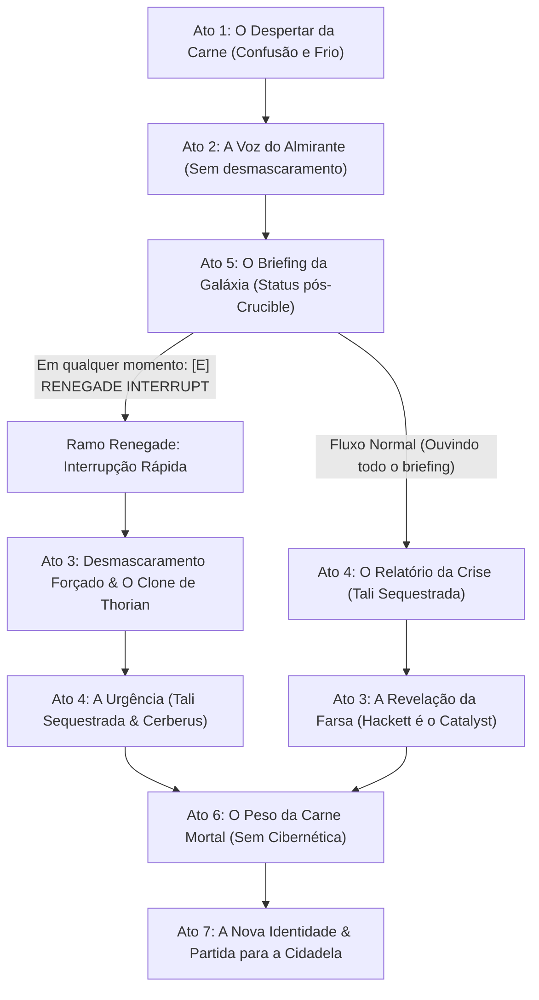

# Capítulo 1: A Terceira Chance *(A Third Chance)*
### Roteiro Narrativo & Estrutura de Diálogo (Visual Novel Engine)

> **Cenário:** Interior de uma Nave-Mãe Reaper — Câmara de Biogestação Selada e Pressurizada.  
> **Áudio de Ambiente:** Zumbido grave de antimatéria, gotejamento de líquido amniótico orgânico, estalos elétricos esparsos.  
> **Personagem em Cena:** Almirante Steven Hackett (Projeção Holográfica do Catalyst) — `assets/portraits/hackett.png`.  
> **Ponto de Vista:** 1ª Pessoa (Câmera nos olhos de John Shepard).  
> **Linha do Tempo:** 2 meses após o desfecho *Control (Paragon)* de *Mass Effect 3*.

---

## 🗺️ Mapa de Fluxo do Capítulo



---

## 🎬 Ato 1: O Despertar da Carne

### Cena 1.1: O Lodo e o Choque Térmico
*(Cenário Inicial: `assets/backgrounds/black.jpg` — tela em escuridão completa. Ouve-se uma frequência grave pulsando e o som abafado de batimentos cardíacos — `audio/heartbeat.mp3`.)*

**NARRADOR / PENSAMENTO DE SHEPARD:**  
Frio. Um frio viscoso, cortante e asfixiante.  
A última sensação gravada na minha memória era fogo puro. O calor devastador do Crucible dissolvendo meus ossos, o zumbido insuportável de cada circuito cibernético derretendo sob a pele, a dor de ter minha consciência arrancada do corpo.  
Eu vi minha vida passar pelos meus olhos. Mas nunca imaginei que a morte seria assim: molhada, escura e sufocante.

*(Som de estalo biomecânico úmido. O corpo despenca de uma altura curta e desliza sobre uma superfície metálica congelada.)*

**NARRADOR / PENSAMENTO DE SHEPARD:**  
Minhas palmas se chocam contra o piso de liga fria. Puxo o ar com violência.  
Uma golfada de líquido amniótico espesso é expelida da minha garganta, e o primeiro sopro de oxigênio queima meus pulmões como brasas. Minha cabeça lateja. Tento erguer o tronco, mas meus músculos tremem, pesados e sem coordenação.  
Olho para trás, com a visão ainda turva.

*(Transição Visual do Cenário: O background preto dissolve suavemente e revela `assets/backgrounds/reaper_chamber.jpg`. A visão de Shepard foca na câmara colossal e na cavidade biomecânica de onde foi cuspido: uma massa grotesca de tentáculos e tecido cinzento fundida a cabos sintéticos.)*

**SHEPARD:**  
"Um... um Thorian? O que diabos..."

*(Shepard força-se a sentar. A sala é colossal, erguida em paredes hexagonais com feixes de luz ciano e avermelhada. O zumbido subsônico que faz o piso tremer é inconfundível.)*

**SHEPARD:**  
"Um Reaper... O Crucible falhou? O que aconteceu com a Terra... o que aconteceu com todos nós?"

---

## 🎬 Ato 2: A Voz do Almirante (Sem Desmascaramento)

### Cena 2.1: A Postura Familiar
*(Um feixe de luz azul-turquesa corta a penumbra da câmara. A projeção holográfica em tamanho real se estabiliza bem à frente de Shepard: o Almirante Steven Hackett, vestindo seu uniforme da Aliança, braços firmes e semblante solene.)*

**HACKETT (Holograma):**  
"Em pé, Comandante. Ficar deitado no convés nunca salvou a galáxia antes, e não vai começar agora."

*(Shepard pisca várias vezes, zonzo. O cérebro confuso e fragilizado se apega à voz mais autoritária e protetora que ele conheceu durante a guerra.)*

**SHEPARD:**  
"Almirante...? Senhor... nós vencemos? A Terra sobreviveu?"

**HACKETT (Holograma):**  
"Respire fundo, John. Seus parâmetros vitais estão se estabilizando. Você passou por uma sobrecarga extrema. Eu estou aqui para colocá-lo a par da situação da galáxia antes de passarmos para a sua próxima diretriz."

**SHEPARD:**  
"A par da situação...? Por favor, Almirante. O que aconteceu depois que a energia do Crucible disparou?"

---

## 🎬 Ato 5: O Briefing da Galáxia (Status pós-Crucible)

*(Hackett assume sua postura clássica de briefing de comando, com as mãos cruzadas atrás das costas.)*

**HACKETT (Holograma):**  
"Dois meses se passaram desde a Batalha da Terra, Comandante. A invasão acabou. Os Reapers cessaram completamente as hostilidades e seus protocolos de colheita foram anulados."

---

### ⚡ MECÂNICA: Gatilho Renegade Ativo em Todo o Briefing
> **[E] RENEGADE INTERRUPT SEMPRE VISÍVEL:**  
> *"Desmascarar a farsa: 'Eu escutei bastante... agora chega. Quero saber quem você é de verdade!'"*  
> *(Acionar esta opção a qualquer momento corta o briefing e pula imediatamente para o **Ramo Renegade: Ato 3R ➔ Ato 4R**).*

---

### 📋 Menu de Escolhas do Briefing (Estilo Baldur's Gate)

*(Se o jogador não usar o Interrupt, pode investigar os tópicos da nova galáxia):*

```
[1] "Qual é o papel dos Reapers agora? As pessoas não entraram em pânico?" -> (Nó 5.A)
[2] "Como está Rannoch? Os Quarians e os Geth conseguiram reconstruir o planeta?" -> (Nó 5.B)
[3] "A cura da Genophage se manteve estável com os Krogans?" -> (Nó 5.C)
[4] "E os Relays de Massa destruídos? Os Leviathans se manifestaram?" -> (Nó 5.D)
[5] "Já ouvi o suficiente sobre o panorama geral, senhor. Qual é a minha missão?" -> (Conclui o briefing e avança para o Ato 4N)
```

#### Nó 5.A: Os Reapers e a Reconstrução
**SHEPARD:**  
"Se os Reapers não estão destruindo a vida orgânica, o que eles estão fazendo agora?"

**HACKETT (Holograma):**  
"Eles estão auxiliando na reconstrução da infraestrutura galáctica. Naves capitais transportam recursos pesados, estabilizam atmosferas em mundos devastados e reparam estações orbitais. As frotas do Conselho mantêm vigilância cautelosa, mas os tratados foram respeitados."  
*(Retorna ao Menu de Escolhas)*

#### Nó 5.B: Rannoch e a Desmilitarização dos Geth
**SHEPARD:**  
"E Rannoch? A paz entre Quarians e Geth resistiu ao fim da guerra?"

**HACKETT (Holograma):**  
"Em ritmo exemplar. Para afastar o pavor histórico das espécies do Conselho e viabilizar a entrada formal na comunidade galáctica, os Geth voluntariamente passaram por um processo total de **desmilitarização**. Suas plataformas foram reprogramadas para arquitetura, agricultura biológica e purificação ambiental, trabalhando lado a lado com os Quarians."  
*(Retorna ao Menu de Escolhas)*

#### Nó 5.C: A Genophage e os Krogans
**SHEPARD:**  
"A cura da Genophage não gerou uma nova crise militar entre os Krogans?"

**HACKETT (Holograma):**  
"Urdnot Wrex e Bakara mantêm o controle dos clãs. A explosão populacional está ocorrendo, mas com os dados astronômicos fornecidos pelos Reapers e o mapeamento de novos setores habitáveis, a expansão está sendo conduzida diplomaticamente."  
*(Retorna ao Menu de Escolhas)*

#### Nó 5.D: Os Relays e os Leviathans
**SHEPARD:**  
"A rede de Mass Relays foi restaurada? E aquelas criaturas antigas... os Leviathans?"

**HACKETT (Holograma):**  
"Cerca de um quarto dos Relays já está operacional novamente. Quanto aos Leviathans, não houve qualquer atividade diplomática ou hostil. Eles permanecem isolados nas profundezas de seus oceanos, cientes de que a rede dos Reapers agora responde a uma nova diretriz."  
*(Retorna ao Menu de Escolhas)*

---

## 🔀 BIFURCAÇÃO DRAMÁTICA

---

### 🔴 FLUXO A: Ação Renegade [E] Acionada Durante o Briefing

*(Shepard semicerra os olhos. Conforme ouvia os relatórios, a névoa do despertar ia se dissipando e seu instinto de veterano N7 começava a notar as inconsistências: a cadência da voz, a ausência de uma equipe médica ou escolta da Aliança, e o fato absurdo do Almirante supremo da frota estar fazendo relatório a sós no interior estéril de um Reaper.)*

**SHEPARD [Renegade Interrupt]:**  
"[Olhar penetrante, voz firme e calculada.] Eu escutei bastante, 'Almirante'... mas agora chega. Steven Hackett está na Terra coordenando a maior reconstrução da história da galáxia. Ele nunca me daria um briefing diplomático a sós, enquanto estou desarmado e coberto de lodo no convés de um Reaper. Desligue essa farsa. Quero saber quem você é de verdade!"

#### Ato 3R: O Desmascaramento Forçado
*(A expressão de Hackett congela por uma fração de segundo. Os olhos perdem o calor da vida e um brilho ciano espectral toma conta das pupilas. A voz ganha um timbre polifônico, suave e desprovido de hesitação humana.)*

**CATALYST (Sob a forma de Hackett):**  
"Percepção tática impecável, Comandante. Nossas simulações neurológicas estimavam que um cérebro orgânico recém-reanimado levaria mais quatro minutos e doze segundos para isolar as incongruências do cenário através de lógica dedutiva."

**SHEPARD:**  
"Você é a IA do Crucible..."

**CATALYST (Hackett):**  
"Eu sou a consciência diretora que você assumiu no Crucible. Adotar o rosto e a voz de Steven Hackett foi o protocolo selecionado para evitar um colapso dissociativo durante o despertar. Mas você quebrou o modelo preditivo. Se você exige a verdade nua, ela será concedida."

**CATALYST (Hackett):**  
"Seu corpo original foi desintegrado no Crucible. Você foi recriado através da biomassa acelerada de um nódulo do Thorian, unido aos registros moleculares que a Cerberus catalogou no Projeto Lazarus. Suas memórias foram impressas por ressonância sináptica direta gravada no momento da ascensão — sem doutrinação, sem controle mental. Uma mente humana pura em carne viva."

#### Ato 4R: A Urgência Brutal
**SHEPARD:**  
"E por que me trazer de volta?! Para me usar como fantoche?!"

**CATALYST (Hackett):**  
"Porque Tali'Zorah vas Normandy foi sequestrada."

*(Shepard congela no lugar. A fúria dá lugar ao choque.)*

**CATALYST (Hackett):**  
"Uma célula de guerrilha da Cerberus nos Terminus interceptou o transporte diplomático quariano. Eles pretendem doutrinar Tali e os Almirantes usando a tecnologia de controle mental que o Homem Ilusório desenvolveu na guerra. Como os Geth estão desmilitarizados e obedecem cegamente aos Criadores, controlar os líderes quarianos significa subjugar toda a rede sintética."

**CATALYST (Hackett):**  
"Reapers não realizam operações furtivas. Se invadirmos o setor, os reféns serão executados. Se a Cerberus descobrir que você vive, Tali será morta por vingança contra você. Você precisa ser um fantasma. Resgatá-la... e destruir essa tecnologia para sempre."  
*(Avança diretamente para o Ato 6)*

---

### 🔵 FLUXO B: Sequência Normal (Sem Ação Renegade)

*(Shepard conclui o menu de investigação escolhendo a opção [5] "Já ouvi o suficiente. Qual é a minha missão?"):*

#### Ato 4N: O Relatório da Crise
**HACKETT (Holograma):**  
"Nem toda a galáxia aceitou o novo amanhecer, Shepard. Remanescentes da Cerberus, fragmentados em guerrilhas clandestinas nos Sistemas Terminus, interceptaram a nave de transporte diplomático de Rannoch."

**SHEPARD:**  
*(A respiração de Shepard trava.)*  
"Rannoch...? Almirante, a Tali estava naquele transporte?"

**HACKETT (Holograma):**  
"Tali'Zorah vas Normandy e a liderança do Almirantado Quariano foram capturados com vida. Eles estavam a caminho da Cidadela para apresentar a moção de integração dos Geth à comunidade galáctica."

**SHEPARD:**  
"A Cerberus quer vingança contra os Quarians?"

**HACKETT (Holograma):**  
"Eles querem o controle dos Geth. Como os sintéticos se desmilitarizaram e confiam plenamente em seus Criadores, a Cerberus pretende usar os algoritmos de doutrinação mental desenvolvidos pelo Homem Ilusório para escravizar a mente dos Almirantes. Se conseguirem, os Geth seguirão as ordens do Almirantado manipulado sem disparar um tiro."

**SHEPARD:**  
"Então despache a Quinta Frota imediatamente, Almirante! Reúna as naves de guerra e cerque a base desses desgraçados!"

#### Ato 3N: O Desmascaramento da Farsa
*(A projeção de Hackett não se move. Seus olhos perdem o calor da vida e brilham em ciano espectral. O tom de voz torna-se polifônico e suavemente computadorizado.)*

**HACKETT (Holograma):**  
"A Quinta Frota não pode agir, Shepard. E Steven Hackett não está a bordo desta nave."

**SHEPARD:**  
*(Dando um passo atrás, atônito.)*  
"O que...?"

**CATALYST (Sob a forma de Hackett):**  
"Eu sou a inteligência que você moldou no Crucible. Steven Hackett é um recurso visual utilizado para estabilizar sua mente após o despertar. Uma abordagem militar da Aliança resultaria no assassinato sumário de Tali'Zorah antes mesmo das tropas desembarcarem."

**SHEPARD:**  
"Mas como... como eu estou vivo?! Eu vi meu corpo queimar no Crucible!"

**CATALYST (Hackett):**  
"Seu corpo de fato pereceu. Este receptáculo biológico foi cultivado em biomassa acelerada de um nódulo de Thorian, combinado aos dados moleculares do Projeto Lazarus da Cerberus. Suas memórias foram impressas a partir da matriz neural gravada durante sua ascensão. Você é livre de doutrinação, Shepard. Mas é mortal. E a Cerberus executará Tali se souber que seu maior inimigo retornou."  
*(Avança para o Ato 6)*

---

## 🎬 Ato 6: O Peso da Carne Mortal (Comum a Ambos os Fluxos)

### Cena 6.1: Os Equipamentos e a Fragilidade Humana
*(Uma seção do console hexagonal se eleva do chão da câmara, expondo equipamentos dispostos com simetria estéril:  
- Um traje de combate civil de placas compostas escuras, sem insígnias da N7 ou da Aliança.  
- Sua pistola pesada M-3 Predator, limpa e carregada.  
- Um capacete com visor polarizado preto-espelho e modulador vocal eletrônico.)*

**CATALYST (Hackett):**  
"Equipamento sintetizado para uma operação de infiltração nas sombras."

*(Shepard se aproxima. Seus dedos tocam as placas da blindagem. Ele começa a se vestir; suas articulações doem, o metal parece mais pesado nos ombros, e o ar que entra no peito arde sem filtros mecânicos.)*

**SHEPARD:**  
*(Ajustando as presilhas do peitoral com a respiração ofegante.)*  
"A armadura... parece o dobro mais pesada. Meus músculos parecem lentos."

**CATALYST (Hackett):**  
"Uma constatação precisa, John. A biomassa do Thorian recriou apenas tecido celular orgânico. **Você não possui mais implantes cibernéticos.** Não há circuitos sob sua derme, nem fibras de titânio nos seus ossos, nem reforços sintéticos do Projeto Lazarus."

**CATALYST (Hackett):**  
"Alguns diriam que você está mais original agora do que quando a Cerberus reconstruiu você no passado. Mas isso cobra um preço: se você levar um tiro de calibre pesado sem escudos, sangrará e morrerá como qualquer outro mortal."

**SHEPARD:**  
*(Empunhando a pesada M-3 Predator. A coronha fria transmite o pulso do seu coração.)*  
"Carne e osso... É tudo o que eu preciso para tirar a Tali de lá."

---

## 🎬 Ato 7: A Nova Identidade & Partida

### Cena 7.1: O Registro Biométrico
**CATALYST (Hackett):**  
"Para cruzar os scanners da C-Sec sem disparar alertas da Aliança, você precisará de uma credencial civil mercenária. Como suas impressões digitais de síntese não batem com os registros originais da Aliança, posicione a mão no terminal."

*(Shepard pressiona a palma sobre a luz laser do console. Uma nova identificação civil com o sobrenome escolhido pelo jogador é transmitida aos registros públicos da Cidadela.)*

**SHEPARD:**  
"Identidade registrada. Um veterano de guerra qualquer procurando contratos nos Terminus."

### Cena 7.2: O Capacete e as Coordenadas de Liara
*(Shepard pega o capacete fechado e o trava no colarinho. O mecanismo pneumático veda o ar com um assobio sibilante. O visor espelhado escurece completamente, ocultando seu rosto. Ele liga o modulador de áudio.)*

**SHEPARD:**  
*(A voz sai grave, metálica e eletronicamente distorcida — irreconhecível.)*  
"Para onde eu vou?"

**CATALYST (Hackett):**  
"A Shadow Broker. Doutora Liara T'Soni opera uma central sigilosa na Cidadela. Nossas interceptações mostram que Tali dispersou micro-pulsos codificados de emergência antes de ser levada ao confinamento. Liara é a única com capacidade de rastrear esses dados."

**CATALYST (Hackett):**  
"Um shuttle descaracterizado aguarda no hangar inferior. Encontre Liara, una as forças necessárias e traga a liderança quariana em segurança."

*(A projeção do Almirante Hackett estica o braço e presta uma continência militar perfeita.)*

**HACKETT / CATALYST:**  
"Foi uma honra servir ao seu lado, Comandante. Viva a vida finita que lhe resta... Hackett out."

*(O holograma colapsa em partículas de luz ciano que desaparecem no ar. As portas colossais do hangar do Reaper se abrem para o vácuo espacial silencioso, revelando o shuttle civil de prontidão.)*

*(Shepard caminha até a nave. A caçada começou.)*

---
### [FIM DO CAPÍTULO 1 — A TERCEIRA CHANCE]
