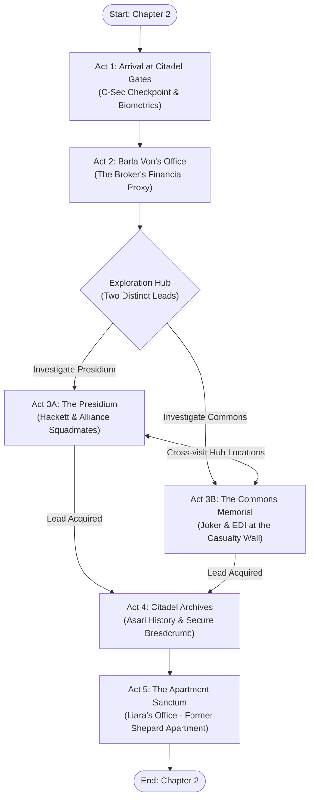
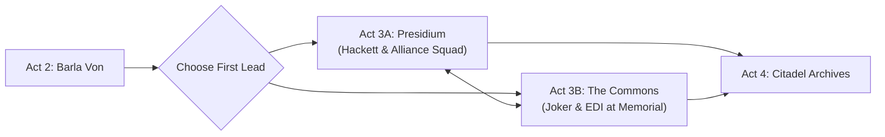

# Chapter 2: Dossier: Shadow Broker
### Narrative Concept & Scene Outline (Visual Novel Engine)

> **Setting:** The Citadel (C-Sec Docks Checkpoint, Financial District, Presidium Embassy Walkway, Commons War Memorial, Citadel Archives, Shepard's Former Apartment / Liara's Covert Sanctum).  
> **Protagonist:** Commander John Shepard (First-person POV; anonymous mercenary armor, polarized visor, electronic voice modulator).  
> **Atmosphere:** Sci-fi espionage, noir investigation, high emotional stakes, bittersweet anonymity among surviving comrades.  
> **Timeline:** Days after departing the Reaper bio-gestation vessel in *Chapter 1: A Third Chance*.  
> **Narrative Reference:** Aligns with [`docs/planejamento.md`](../planejamento.md) (Mission 1: Contact in the Shadows) and the architecture in [`docs/Capitulo 2 - bpmn/diagram.bpmn`](../Capitulo%202%20-%20bpmn/diagram.bpmn).

---

## 🗺️ Chapter Architecture & Flowchart

The chapter structure faithfully adapts the BPMN process flow ([`diagram.bpmn`](../Capitulo%202%20-%20bpmn/diagram.bpmn)):

---

## 🎬 Act 1: Arrival at Citadel Gates (The Masked Infiltrator)

### Scene Summary
* **Location:** `assets/backgrounds/citadel_docks.webp`
* **Characters Present:** Shepard (POV), C-Sec Inspection Officer, ambient docks crowd.
* **Audio:** Distant ship thrusters, PA announcement chimes in multiple alien tongues, hiss of atmospheric scrubbers, Shepard's filtered breathing inside the helmet.

### Narrative Concept & Dramatic Focus
Shepard disembarks from a civilian cargo shuttle at the rebuilt Citadel docks. He wears unmarked mercenary battle plating with zero Alliance insignia, his face concealed behind an opaque polarized visor and his speech filtered through a rasping electronic modulator.

For the first time since the Battle of Earth, John walks among living citizens. The Citadel smells of ozone, industrial sealant, and recycled air. His newly grown organic body feels every ounce of weight: no synthetic servos, no titanium-threaded muscles—just flesh, raw pulse, and bone.

At the C-Sec checkpoint, the automated scanner chirps. Because John’s physical body was recreated via accelerated synthesis rather than standard human birth records, his biometric and dermal ridges register as an unindexed Terminus mercenary.
* **Tension:** A tense interrogation with a C-Sec officer wary of Terminus free-agents.
* **Choices (Baldur's Gate Style):**
  1. *"I'm here on legitimate freelance salvage business. Check the docking clearance codes."* (Pragmatic/Calm)
  2. *"Unless I've broken Council station law, step aside and let me through."* (Renegade/Direct)
  3. *"The Citadel looks remarkably intact. Credit to the repair crews."* (Investigative/Polite)
* **Outcome:** Shepard clears security without raising flags, maintaining his ghost identity.

---

## 🎬 Act 2: Barla Von's Office (The Broker's Financial Proxy)

### Scene Summary
* **Location:** `assets/backgrounds/financial_district.webp`
* **Characters Present:** Shepard (POV), Barla Von (Volus Financial Agent).
* **Audio:** Ambient electronic market tickers, Volus pressurized breathing suit suits (`*hiss-pant*`).

### Narrative Concept & Dramatic Focus
To contact the elusive Shadow Broker without triggering galactic comms surveillance, Shepard visits the Financial District. He approaches Barla Von, the seasoned Volus accountant who has managed financial assets for the Shadow Broker since before the Collector Crisis.

Barla Von is naturally suspicious of an armored mercenary asking discreet questions about Dr. Liara T'Soni. Shepard must navigate the dialogue carefully: reveal enough insider knowledge to prove he isn't an assassin, but conceal his true identity from the accountant.

* **Dialogue Highlights:**
  - Barla Von warns that Dr. T'Soni is guarded by top-tier biotic and digital counter-measures. She does not take unsolicited visitors.
  - To authorize an audience key or relay a rendezvous packet, Barla Von requires authentication or verification from current station activity.
  - He points Shepard toward two specific sectors where the Broker's covert network has detected anomalous activity and security patrols:
    - **Lead A (Presidium):** High-level Alliance command movement around the embassies.
    - **Lead B (The Commons):** Encrypted comms relays hidden near the new public war memorials.

---

## 🎬 Act 3: The Exploration Hub (Presidium & The Commons)

The player enters an open two-pronged investigation hub. Both locations can be explored in any order, with optional cross-travel between them.

### 🏛️ Act 3A: The Presidium (The Old Guard)
* **Location:** `assets/backgrounds/presidium_embassy.webp`
* **Characters Present:** Shepard (POV), Admiral Steven Hackett, companion/Alliance guards (e.g., Ashley/Kaidan or James Vega in the background).
* **Audio:** Serene Presidium water fountains, distant diplomatic chatter, solemn military cadence.
* **Dramatic Focus:**
  - Shepard observes Admiral Hackett from a balcony overlooking the Embassy gardens. Hackett is in deep discussion regarding fleet redeployment and Terminus security treaties.
  - **The Emotional Squeeze:** In Chapter 1, Shepard spoke with a holographic projection of Hackett generated by the Catalyst. Seeing the real, living Admiral in the flesh—visibly older, carrying the trauma of Earth's defense—strikes Shepard deeply.
  - Shepard cannot step forward or salute without exposing his survival and jeopardizing Tali’s life.
  - **Interactive Beat:** An Alliance security detail questions the armored mercenary lingering near the diplomatic promenade. Shepard must either talk his way out, use military jargon to command respect, or blend into the crowd, acquiring a diplomatic clearance cipher key in the process.

### 🕊️ Act 3B: The Commons (The Memorial of the Fallen)
* **Location:** `assets/backgrounds/citadel_commons_memorial.webp`
* **Characters Present:** Shepard (POV), Jeff "Joker" Moreau, EDI (in her infiltration platform).
* **Audio:** Soft, poignant orchestral motif, hushed whispers of mourning citizens, Joker’s distinctive voice cracked with grief.
* **Dramatic Focus:**
  - In the central plaza stands a massive black obsidian memorial wall, etched with thousands of names of soldiers and civilians lost during the Reaper invasion.
  - Shepard spots two familiar figures standing before the wall: **Joker and EDI**.
  - Joker is staring directly at the carved letters reading: ***Commander John Shepard - SSV Normandy SR-2***.
  - Joker speaks softly, reminiscing with bitter humor to mask his heartbreak. EDI stands beside him, gently resting a synthetic hand on his shoulder, analyzing human mourning rituals and validating Jeff’s emotions.
  - **Shepard’s POV Internal Monologue:** The urge to take off the helmet, walk up, and punch Joker on the arm is overwhelming. John’s throat tightens; his breath fogs the inside of the visor. But he clenches his gauntlets and stays silent.
  - **Mechanic / Interrupt:** A [Paragon Interrupt [Q]] allows Shepard to lay a token or salute silently at the base of the wall behind Joker before slipping away unseen.

---

## 🎬 Act 4: The Citadel Archives (Asari Lore & The Breadcrumb)

### Scene Summary
* **Location:** `assets/backgrounds/citadel_archives.webp`
* **Characters Present:** Shepard (POV), holographic archive guides, security sensors.
* **Audio:** Echoing marble halls, soft hum of Prothean and Asari data-vaults, electronic terminal chime.

### Narrative Concept & Dramatic Focus
Using the clearance data gathered from Barla Von and the Presidium/Commons investigation, Shepard accesses the historic Citadel Archives (the site of the historic Citadel DLC archive heist).

* **The Historical Review:** The archives showcase exhibits documenting Asari history, the cultural trauma of the Fall of Thessia, and the ancient Prothean beacons that shaped Asari supremacy.
* **The Broker's Breadcrumb:** Liara has woven covert Shadow Broker data-nodes into the public historical displays. Shepard interacts with a secure terminal disguised as an Asari academic kiosk.
* **The Revelation:** By decrypting the emergency subroutines, Shepard decodes Liara's personal secure location on the station. She is not operating out of the embassies or a warship.
* **The Location:** She has secured a penthouse apartment in the Silversun Strip—**Shepard's former luxury apartment**.

---

## 🎬 Act 5: The Apartment Sanctum (Face to Face with Liara)

### Scene Summary
* **Location:** `assets/backgrounds/shepard_apartment.webp`
* **Characters Present:** Shepard (POV), Dr. Liara T'Soni.
* **Audio:** Heavy hydraulic door lock engaging, subtle biotics crackling, tense cinematic ambient music.

### Narrative Concept & Dramatic Climax
Shepard ascends to the private penthouse in the Silversun Strip. The entrance is dead quiet. As he steps into the grand living area, security lockdowns slam shut behind him: blast shutters seal the windows and the airlocks deadbolt.

A bright azure biotic field ignites in the shadows. **Dr. Liara T'Soni** steps into view, her eyes glowing with dark energy, a heavy pistol aimed directly at the armored mercenary's chest.

* **The Standoff:**
  - Liara demands to know who contracted him, how he bypassed her encryption, and why an unknown mercenary is tracking Shadow Broker relays.
  - Shepard, speaking through the metallic vocal modulator, asks her to seal all communication channels to the room.
  - **Dialogue Choices (Baldur's Gate Style):**
    1. *"Your biotic barriers are as sharp as ever, Liara. But you always did leave a blind spot on the service lifts."*
    2. *"Lower the weapon. If I wanted to harm the Shadow Broker, I wouldn't have come alone."*
    3. *"Tali is in grave danger, Liara. We don't have time for guns."*
* **The Unmasking:**
  - Shepard reaches up to his collar. Seals release with an audible hiss of compressed air.
  - He lifts the heavy helmet and sets it down on the counter.
  - **Visual & Emotional Impact:** Liara’s biotics instantly extinguish. Her pistol drops an inch. She freezes in utter, paralyzing shock, staring at John Shepard's living face—unaugmented, breathing, real.
* **Ending Hook (Bridge to Chapter 3 / Embrace the Eternity):**
  - Liara whispers in horror and wonder: *"By the Goddess... that is impossible. You died on the Crucible!"*
  - Shepard steps forward, offering his hand: *"It's me, Liara. Connect with me. Look into my mind."*
  - Fade to black as Liara prepares to initiate the *Embrace the Eternity* mind-meld to verify his true consciousness.

---

## 🛠️ Implementation Plan for Engine (`data/chapters/2.dossier-shadow-broker/`)

When this script is finalized and approved, it will be implemented in modular ES modules matching Chapter 1:

1. `1.citadel-gates.js` — Dock arrival, sensory description, C-Sec checkpoint dialogue.
2. `2.barla-von.js` — Interaction with Barla Von, financial district ambiance, receiving the two leads.
3. `3a.presidium-hackett.js` — Eavesdropping on Hackett, emotional restraint, security clearance node.
4. `3b.commons-memorial.js` — Joker & EDI at the memorial wall, silent vigil, optional Paragon token interrupt.
5. `4.citadel-archives.js` — Decrypting the kiosk in the Asari history exhibit, locating the apartment address.
6. `5.apartment-sanctum.js` — Biotic standoff, verbal banter, unmasking sequence, and chapter resolution.
7. `index.js` — Consolidates all nodes into `chapter02` and registers with `data/stories.js`.
