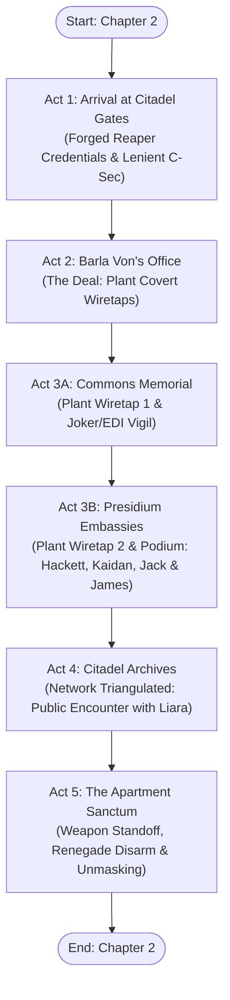
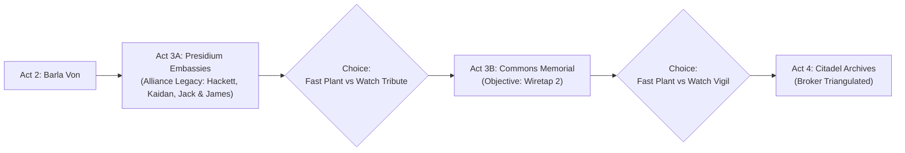

# Chapter 2: Dossier: Shadow Broker
### Narrative Concept & Scene Outline (Visual Novel Engine)

> **Setting:** The Citadel (C-Sec Docks Checkpoint, Financial District, Presidium Embassy Walkway, Commons War Memorial, Citadel Archives, Shepard's Former Apartment / Liara's Covert Sanctum).  
> **Protagonist:** Commander John Shepard (First-person POV; anonymous mercenary armor, polarized visor, electronic voice modulator).  
> **Atmosphere:** Sci-fi espionage, noir investigation, high emotional stakes, bittersweet anonymity among surviving comrades.  
> **Timeline:** Days after departing the Reaper bio-gestation vessel in *Chapter 1: A Third Chance*.  
> **Narrative Reference:** Aligns with [`docs/planejamento.md`](../planejamento.md) (Mission 1: Contact in the Shadows) and the architecture in [`docs/Capitulo 2 - bpmn/diagram.bpmn`](../Capitulo%202%20-%20bpmn/diagram.bpmn).

---

## 📖 Resumo Geral do Capítulo (Executive Narrative Summary)

Este capítulo retrata a infiltração de John Shepard na Citadel após seu renascimento como mortal, operando sob o disfarce de um mercenário anônimo para estabelecer contato seguro com a Shadow Broker sem revelar sua sobrevivência à galáxia ou à Cerberus.

* **Ato 1: Chegada às Docas da Citadel (O Infiltrador Mascarado):**
  - Shepard desembarca de um cargueiro civil descaracterizado usando blindagem pesada sem insígnias, visor polarizado opaco e modulador vocal eletrônico.
  - No posto de inspeção de C-Sec, a identidade civil de contratante forjada com perfeição pelos Reapers (Catalyst) permite que ele entre sem dificuldades. Como a Citadel ainda se recupera da devastação da invasão, milhões de registros governamentais foram perdidos, servidores estão corrompidos e incontáveis cidadãos estão deslocados ou desaparecidos. A C-Sec, exausta e sobrecarregada com reconstrução e logística humanitária, opera sob protocolos mais tolerantes e flexíveis, liberando o mercenário sem complicações burocráticas.
* **Ato 2: O Escritório de Barla Von (A Missão das Escutas):**
  - Para localizar Liara sem acionar varreduras na extranet pública, Shepard vai ao Distrito Financeiro e aborda Barla Von.
  - Barla Von reconhece a autoridade de Shepard sobre a Shadow Broker e explica que a rede local sofreu severos danos na invasão. Ele entrega duas micro-escutas militares em sequência obrigatória:
    1. Primeiro no terminal do **Commons (Memorial dos Caídos)**;
    2. Segundo no nó de comunicações do **Presidium (Embaixadas)**, triangulando a Broker diretamente para os Arquivos.
* **Ato 3: A Operação das Escutas (Commons Memorial & Presidium Embassies):**
  - Uma missão perfeitamente linear e profundamente emocional:
    - **Ato 3A (Commons - O Memorial dos Caídos):** Shepard vai ao terminal da praça central para fixar a primeira escuta. Ele presencia Joker e EDI velando o nome de *Commander John Shepard* no mural de obsidiana, com a oportunidade de acionar o Paragon Interrupt `[Q]` para prestar uma homenagem silenciosa. Escuta 1 online (50%).
    - **Ato 3B (Presidium - O Legado da Aliança: Hackett & Pódio [Jack, Kaidan, James]):** Shepard segue para o Presidium e instala a segunda escuta (sinal 100%). Em seguida, presencia a comovente cerimônia da Aliança: o Almirante Steven Hackett discursa sobre a coragem de Shepard e a união galáctica. Em seguida, o Major Kaidan Alenko (Spectre) sobe ao pódio acompanhado de seus novos candidatos no palco em formação de trio: **James Vega** e **Jack**. Kaidan homenageia Shepard como seu mentor e promete manter seu legado vivo. Shepard observa seus antigos companheiros das sombras com imenso orgulho e parte em direção aos Arquivos.
    - Concluídas as duas instalações, a rede da Shadow Broker se sincroniza e revela que Liara está nos Arquivos da Citadel (logo ao lado no anel do Presidium).
* **Ato 4: Os Arquivos da Citadel (O Lore Asari & A Isca de Tali):**
  - Os Arquivos estão em plena reconstrução pós-guerra, com diversos historiadores Asari, curadores e pesquisadores comparando relíquias e dados históricos resgatados da queda de Thessia.
  - **Liara T'Soni está no local em sua faceta pública:** renomada arqueóloga, especialista em Protheanos e heroína de guerra da Normandy, agindo como acadêmica normal (`Dra. Liara T'Soni // Arqueóloga & Historiadora`).
  - Shepard não possui os sinais digitais de Tali, mas **carrega uma verdade explosiva e ultra-secreta que a galáxia ainda ignora:** o transporte diplomático de Rannoch foi sequestrado por uma célula da Cerberus e Tali'Zorah é refém.
  - Aproximando-se discretamente com um datapad, Shepard lança a isca tática e oferece ajuda. Abalada, Liara mantém sua compostura pública e convoca o mercenário para uma sala blindada e fora do radar: a cobertura no Silversun Strip.
* **Ato 5: O Santuário no Apartamento (Impasse Armado, Renegade Disarm & Desmascaramento):**
  - Shepard e Liara chegam ao antigo apartamento de luxo de Shepard no Silversun Strip. As persianas blindadas descem e as comunicações são bloqueadas.
  - Desconfiada e em alerta máximo, Liara puxa sua pistola pesada M-5 Phalanx com campo biótico armado.
  - **Renegade Interrupt `[E]`:** Em um reflexo N7 instantâneo, Shepard avança, desarma Liara e desmonta a pistola inteira em campo em menos de dois segundos, espalhando as peças inofensivas no balcão da cozinha.
  - Shepard despressuriza os lacres pneumáticos do capacete e revela seu rosto vivo e humano. O choque emocional e as lágrimas quebram a postura da Shadow Broker.
  - **A Revelação do Apartamento:** Ao ver Shepard reconhecer perplexo seu antigo lar, Liara conta a história que ele desconhecia:
    - No testamento militar de Shepard, o apartamento de luxo do Silversun Strip ficou como herança para **Tali'Zorah**.
    - Tali vendeu a propriedade para Liara por três motivos cruciais:
      1. Estava partindo para Rannoch para liderar a reconstrução de seu mundo natal ao lado dos Geth;
      2. Permanecer naquele apartamento trazia uma dor insuportável, pois cada cômodo evocava a ausência de John e as memórias vivas da festa da Citadel;
      3. Liara precisava desesperadamente de uma base fortificada e totalmente fora do radar da Citadel para reerguer a rede de espionagem da Shadow Broker.
    - Essa revelação torna o ato prévio de Liara levar um mercenário desconhecido até ali infinitamente mais poético, tenso e carregado de vulnerabilidade.
  - O capítulo se encerra com o convite ao *Embrace the Eternity*, onde Liara toca as têmporas de John para validar sua mente e planejar o resgate de Tali.

---

## 🗺️ Chapter Architecture & Flowchart

The chapter structure faithfully adapts the BPMN process flow ([`diagram.bpmn`](../Capitulo%202%20-%20bpmn/diagram.bpmn)):

---

## 🎬 Act 1: Arrival at Citadel Gates (The Masked Infiltrator)

### Scene Summary
* **Location:** `assets/backgrounds/citadel_docks.webp`
* **Characters Present:** Shepard (POV), C-Sec Inspection Officer, ambient docks crowd.

### Narrative Concept & Dramatic Focus
Shepard disembarks from a civilian cargo shuttle at the rebuilt Citadel docks. He wears unmarked mercenary battle plating with zero Alliance insignia, his face concealed behind an opaque polarized visor and his speech filtered through a rasping electronic modulator.

For the first time since the Battle of Earth, John walks among living citizens. The Citadel smells of ozone, industrial sealant, and recycled air. His newly grown organic body feels every ounce of weight: no synthetic servos, no titanium-threaded muscles—just flesh, raw pulse, and bone.

* **The Security Checkpoint & Post-War Context:**
  - The Citadel is in the throes of massive reconstruction after the Reaper occupation. Station databases are riddled with corrupt sectors, millions of military and civilian files were destroyed, and vast waves of refugees, salvage contractors, and volunteers flood the docks daily.
  - C-Sec is severely understaffed and exhausted; their officers prioritize humanitarian aid and hazardous salvage checks over stringent background checks on every nameless contractor.
  - When Shepard steps through the automated scanner, the civilian contractor identity fabricated by the Catalyst passes the corrupted station databases with ease. The scanner chimes green.
  - The C-Sec officer merely glances at the Terminus salvage credentials, asks a routine customs question, and waves the armored mercenary through without delay.
* **Choices (Baldur's Gate Style):**
  1. *"Freelance salvage contractor. Here to pick up decommissioned components under docket 402."* (Pragmatic/Calm)
  2. *"Papers are clean. Unless Council station law has changed, I'm moving through."* (Renegade/Direct)
  3. *"Citadel reconstruction is coming along remarkably well. Credit to the ground crews."* (Investigative/Polite)
* **Outcome:** Shepard clears security smoothly without raising flags, cementing his ghost identity.

---

## 🎬 Act 2: Barla Von's Office (The Deal: Strategic Wiretaps)

### Scene Summary
* **Location:** `assets/backgrounds/financial_district.webp`
* **Characters Present:** Shepard (POV), Barla Von (Volus Financial Agent).

### Narrative Concept & Dramatic Focus
To contact the elusive Shadow Broker without triggering galactic comms surveillance, Shepard visits the Financial District. He approaches Barla Von, the seasoned Volus accountant who has managed financial and operational assets for the Shadow Broker since before the Collector Crisis.

Barla Von is naturally cautious around an armored mercenary asking discreet questions about Dr. Liara T'Soni. However, Shepard reveals confidential knowledge of the Broker's banking channels that only an insider could know.

* **The Quid Pro Quo (The Wiretaps):**
  - Barla Von explains that the Broker's surveillance network on the Citadel took devastating hits during the Reaper invasion. Critical local relays are completely dark, blinding the Broker's analysts to high-level station movements.
  - Barla Von refuses to hand over Dr. T'Soni's coordinates for free:
    - *"You want to reach Dr. T'Soni, mercenary? *hiss-pant* The Broker's network needs eyes on this station. I have two military-grade micro-wiretaps. Plant them in two high-traffic nexus points where my agents cannot go without drawing scrutiny: the Presidium Embassy relay and the Commons Memorial data hub. Do that, and the telemetry will triangulate Dr. T'Soni's location for you."*
  - Shepard takes the two miniature surveillance transceivers, establishing a clear tactical objective.

---

## 🎬 Act 3: The Wiretap Operation (Presidium & The Commons)

This act flows as a structured, linear intelligence operation across two iconic Citadel sectors. While the path from Act 3A to Act 3B is linear, each zone features deep player interactivity: the player can choose to execute a swift, professional plant-and-go, or linger to engage in profound narrative and emotional beats.

### 🏛️ Act 3A: The Presidium (The Alliance Legacy: Hackett, Kaidan, Jack & James)
* **Location:** `assets/backgrounds/presidium_embassy.webp`
* **Characters Present:** Shepard (POV), Admiral Steven Hackett, Major Kaidan Alenko (Spectre), Lieutenant James Vega, Jack (Subject Zero / Alliance Biotic Specialist), Alliance honor guard, embassy diplomats.
* **Objective:** Plant Wiretap 1 inside the secondary communications junction behind the embassy garden promenade.
* **Dramatic & Interactive Beats:**
  - Shepard reaches the garden mezzanine overlooking the Alliance Embassy courtyard, where a formal diplomatic commendation is taking place before station dignitaries.
  - **Hackett's Address on Galactic Unity:**
    - **Admiral Steven Hackett** addresses the assembly with battle-hardened gravitas: he pays homage to Commander Shepard's unparalleled courage, emphasizing that John was the linchpin who achieved the impossible—uniting the long-feuding species of Citadel space (Turians, Krogans, Asari, Salarians, Quarians, and Geth) to break the Reaper cycle. Hackett declares that honor is best preserved not in statues, but by safeguarding the peace Shepard bought with his life.
  - **Kaidan's Tribute to His Mentor & The Next Generation:**
    - Hackett yields the podium to **Major Kaidan Alenko**, wearing his distinguished Spectre battle dress.
    - Kaidan speaks with raw, heartfelt sincerity: he reflects on their journey from Eden Prime to the Crucible. Shepard was not just his commanding officer—he was his mentor, the leader who taught him integrity under fire and how to lead with conviction. Kaidan openly admits the painful void left by Shepard's absence, but vows to carry John's torch forward.
    - As the premier human Spectre, Kaidan announces his mission to train and mentor the next generation of human Spectre candidates: **Lieutenant James Vega** and **Jack**.
  - **The Squad's Emotional Presence:**
    - **James Vega:** Standing at rigid attention in crisp dress blues, chest adorned with service ribbons; his jaw clenches with solemn pride, his eyes shining with the memory of the Commander who believed in his leadership potential.
    - **Jack:** Standing beside Vega in modified Alliance biotic tactical gear, arms crossed tightly. She fights to maintain her trademark rebellious cynicism, but a subtle tremor in her jaw and the fierce intensity of her stare betray how profoundly she honors the man who gave her a reason to live.
  - **Shepard’s POV Internal Monologue:**
    - Watching his former squad standing united at the peak of galactic leadership overwhelms John with paternal and fraternal pride. His heart swells in his chest; his mortal pulse thumps heavily in his temples.
    - The urge to drop down from the mezzanine, pull off his helmet, call Kaidan by name, clap Vega on the back, and banter with Jack about her Alliance rank is almost unbearable. But he forces his armored boots to stay rooted: exposing his survival would ignite political chaos, paint targets on their backs for Cerberus, and cost Tali her life.
  - **Player Choices (Linear but Interactive):**
    1. *Quick Execution:* Fast-plant the micro-wiretap into the conduit housing, verify the encrypted link to Barla Von's net, and withdraw immediately toward the Commons.
    2. *Linger & Witness the Tribute:* Remain on the balcony to absorb the entire ceremony, listening to Kaidan's oath and Hackett's salute. If an Alliance sentry approaches the lingering mercenary, Shepard utilizes crisp military protocol or flashes forged Terminus salvage dockets to deflect inquiry without blowing his cover.

### 🕊️ Act 3B: The Commons (Memorial Plaza Node & Joker/EDI)
* **Location:** `assets/backgrounds/citadel_commons_memorial.webp`
* **Characters Present:** Shepard (POV), Jeff "Joker" Moreau, EDI (in her infiltration platform), mourning citizens.
* **Objective:** Plant Wiretap 2 into the public data kiosk near the central memorial plaza.
* **Dramatic & Interactive Beats:**
  - In the central plaza stands a massive black obsidian memorial wall, etched with thousands of names of soldiers and civilians lost during the Reaper invasion.
  - Nearby stands **Joker and EDI**. Joker is staring fixedly at the carved letters: ***Commander John Shepard - SSV Normandy SR-2***.
  - Joker speaks softly, reminiscing with bitter humor to mask his heartbreak. EDI stands beside him, gently resting a synthetic hand on his shoulder, analyzing human mourning rituals and validating Jeff’s emotions.
  - **Shepard’s POV Internal Monologue:** The urge to take off the helmet, walk up, and punch Joker on the arm is overwhelming. John’s throat tightens; his breath fogs the inside of the visor. But he clenches his gauntlets and stays silent.
  - **Player Choices (Linear but Interactive):**
    1. *Quick Execution:* Wire the micro-transceiver into the memorial kiosk, verify the handshake, and prepare to move out.
    2. *Linger & Vigil:* Step closer to the plaza edge, witnessing Joker's raw sorrow and EDI's gentle support.
    3. *[Paragon Interrupt [Q]]:* Shepard silently lays an Alliance service token or offers an unobserved military salute at the base of the wall behind Joker before slipping away into the crowd.
* **Mission Resolution:** With both wiretaps active, Barla Von's encrypted telemetry completes the circuit. A secure data-ping flashes inside Shepard's helmet visor: **Dr. Liara T'Soni has been located at the Citadel Archives**.

---

## 🎬 Act 4: The Citadel Archives (Asari Lore & The Public Encounter with Liara)

### Scene Summary
* **Location:** `assets/backgrounds/citadel_archives.webp`
* **Characters Present:** Shepard (POV - anonymous mercenary armor, polarized visor, electronic voice modulator), Dr. Liara T'Soni (in her public persona as renowned archaeologist and historian), archive curators, Salarian and Asari research teams, civilian catalogers.

### Narrative Concept & Dramatic Focus
Using the clearance and telemetry gathered from Barla Von and the investigation in the Presidium/Commons, Shepard tracks the Shadow Broker's covert movements directly to the historic Citadel Archives.

Rather than a desolate crime scene or a secret lair, the archives are **in full swing of post-war restoration and reconstruction**. Teams of Asari historians, Salarian data analysts, and Citadel curators are actively sorting, restoring, and cataloging salvaged cultural records and damaged Prothean relics rescued from the Reaper invasion.

* **Liara in Her Public Element (The Respected Scholar):**
  - Standing before a grand holographic installation restoring the cultural history of Thessia and the lost Temple of Athame is **Dr. Liara T'Soni**.
  - Here, she is not acting as the shadowy spymaster; she presents herself in her legitimate, celebrated public role: world-renowned Prothean archaeologist, respected Asari historian, and heroic veteran of Commander Shepard's Normandy crew.
  - She is dressed in refined academic attire, holding a datapad and consulting politely with a group of Asari and Salarian curators, comparing historical data streams.
  - To the public, she is a pillar of galactic recovery. But behind her professional composure, Shepard can see the deep exhaustion etched into her posture, the silent mourning for her devastated homeworld, and the lingering ache of Shepard's death.
  - **Shepard’s POV Internal Monologue:** Seeing Liara so close—immersed in the scholarly passion she loved before the war consumed her life—twists John's chest with suffocating emotion. His pulse hammers against his temples; his fingers twitch inside his heavy mercenary gauntlets. Every fiber of his soul urges him to rip off his helmet, push past the curators, and hold her tight. But cold military discipline holds him in place: the room is full of scholars, C-Sec surveillance drones hover overhead, and a single careless exposure would alert Cerberus networks and sign Tali's death warrant.

* **The Approach & The Tactical Hook (Classified Intelligence):**
  - Shepard does **not** possess extranet signal tracking or Tali's telemetry breadcrumbs (that level of galactic sensor surveillance is precisely why he needs the Shadow Broker's network).
  - What Shepard possesses is **an explosive, top-secret truth that the public, the Council, and even the Alliance have kept completely in the dark**:
    - The Quarian diplomatic vessel carrying Tali'Zorah and the Admiralty Board did *not* suffer an engine failure or routine communication delay in the Terminus Systems.
    - **They were ambushed and abducted by a covert Cerberus guerrilla cell.**
  - **The Hook:**
    - To attract Liara's attention without causing a public panic or blowing her cover among her colleagues, Shepard approaches her station disguised as an armored field salvage contractor submitting an uncataloged historical telemetry query.
    - As the other curators step back, Shepard steps forward, presenting a datapad. When Liara turns to him with polite, professional courtesy (*"Yes? Can I help you with an archive request, soldier?"*), Shepard leans in and speaks through his low, metallic voice modulator:
      - *"Dr. T'Soni. The Quarian diplomatic transport from Rannoch didn't suffer drive-core instability in the Terminus. It was intercepted by Cerberus black-ops. Tali'Zorah is a captive."*
    - He delivers the insider detail that shatters her academic detachment:
      - *"The Admiralty Board hasn't checked in for 96 hours. The Council thinks it's a communications blackout. But the Illusive Man's hounds don't kidnap Quarian admirals for ransom, Liara. They're after neural control."*

* **Liara's Reaction & Composed Mask:**
  - The revelation hits Liara like a concussive shockwave. Her breath hitches; her fingers tighten around her datapad with white-knuckle intensity.
  - Her Shadow Broker network had indeed flagged a silent Quarian communications anomaly, but **no mercenary in the galaxy could possibly know that Cerberus is behind it, that Tali is aboard, or that mind-control technology is involved**.
  - A master of statecraft and espionage, Liara masks her shock instantly before the nearby curators notice. With practiced grace, she excuses herself:
    - *"Excuse me, colleagues. This contractor has brought high-priority telemetry regarding an unmapped excavation site in the Terminus that requires immediate quarantine analysis in my office."*

* **The Agreement for Off-Grid Secrecy:**
  - In a low whisper, Shepard warns her:
    - *"This pavilion is crawling with C-Sec diagnostic sensors and civilian ears. If the kidnappers realize the Broker has made contact, Tali will be dead before the hour ends. We need an off-grid clean room. Now."*
  - Disturbed, on high combat alert, but desperate to save Tali and deeply unsettled by something eerily familiar in the mercenary's bearing, Liara nods:
    - *"Follow me. Keep your hands where I can see them. One wrong twitch, and you will learn why the Shadow Broker survived the Reapers."*
  - She escorts the masked mercenary off-grid to her ultimate private sanctum on the station: **the luxury penthouse apartment in the Silversun Strip**—John Shepard's former home, though behind his mercenary visor John has no idea yet why or how Liara possesses it.

---

## 🎬 Act 5: The Apartment Sanctum (Weapon Standoff, Renegade Disarm & Unmasking)

### Scene Summary
* **Location:** `assets/backgrounds/shepard_apartment.webp`
* **Characters Present:** Shepard (POV), Dr. Liara T'Soni.

### Narrative Concept & Dramatic Climax
Shepard and Liara arrive at the penthouse in the Silversun Strip—John's former luxury apartment from the Citadel DLC, preserved with quiet, reverent silence. Behind his mercenary visor, John recognizes every familiar angle with an overwhelming surge of emotion, though he maintains tactical discipline.

* **The Penthouse Context & Narrative Staging:**
  - Bringing an anonymous, armed Terminus mercenary into this deeply personal sanctuary demonstrates both the desperate urgency of Tali's peril and an unconscious, instinctual draw Liara felt toward the stranger's disciplined presence.
  - At this moment, Shepard does not yet know how or why Liara possesses his former apartment—a revelation that will unfold only after his identity is revealed.

* **The Sudden Standoff:**
  - The instant both cross the threshold, automated security protocols engage: heavy blast shutters slam down over the panoramic Silversun Strip windows, external airlocks deadbolt with hydraulic force, and military-grade electronic scrambling blankets the room.
  - In that same breath, Liara drops all academic pretense. She whirls around with lethal grace, her eyes igniting with dark energy and an azure biotic warp field flaring across her shoulders.
  - **She draws her heavy M-5 Phalanx pistol, leveling the barrel squarely at Shepard's chest and visor.**
  - Liara's voice is razor-sharp, cold, and commanding:
    - *"The apartment is sealed. Communications are dead. Scanners are scrambled. Nobody leaves until I have the truth. Who contracted you? How do you know the Admiralty was taken by Cerberus? And why do you move like an N7 operator?"*

* **The Interactive Beat: [Renegade Interrupt [E]] — Disarm & Field-Strip:**
  - A dramatic, cinematic **[Renegade Interrupt [E]]** prompt flashes on screen!
  - **If Executed (Renegade Action):**
    - Shepard doesn't raise his hands or retreat. In a blinding reflex drilled through hundreds of combat drops, John closes the gap before Liara can pull the trigger or complete a biotic flare.
    - In one seamless, textbook N7 close-quarters maneuver, his left hand parries her wrist upward while his right hand twists the pistol free from her grasp.
    - Instead of aiming the weapon back at her, Shepard demonstrates legendary tactical mastery:
      - In two seconds flat, his gloved fingers work the slide release, eject the magazine into his palm, disengage the recoil guide, and strip the slide and barrel free.
      - **He completely field-strips her heavy pistol into separate, harmless components**, sliding the slide, barrel, spring, magazine, and frame calmly across the kitchen counter.
    - Liara is left standing frozen, staring at her empty hands and the dismantled weapon on the counter, utterly breathless and disoriented. Only one human in the galaxy ever handled an M-5 Phalanx with that exact muscle-memory cadence.
  - **If Missed / Paragon Alternative:**
    - Shepard remains still, speaking calmly without raising his hands, reciting the exact combat advice he gave Liara during their first deployment on Therum. She slowly lowers the trembling weapon in mounting shock and confusion.

* **The Unmasking & Emotional Climax:**
  - The apartment falls into breathless silence, broken only by Liara's rapid, ragged breathing.
  - Shepard reaches up to the heavy neck latches of his mercenary helmet.
  - The pressurized seals disengage with a loud pneumatic hiss of venting atmosphere (`*pssshhht*`).
  - Shepard lifts off the heavy helmet and sets it down on the counter beside the disassembled pistol.
  - He exhales real, warm, unaugmented human breath.

* **The Living Face & Shattered Grief:**
  - Liara looks up into his exposed face.
  - Her azure biotics extinguish instantly. Her hands begin to tremble violently. Tears immediately spring to her eyes as absolute, paralyzing shock replaces her combat focus.
  - Standing before her is **John Shepard**—not a hologram, not a clone, not a Cerberus puppet with glowing synthetic scars, but his living, breathing, unaugmented flesh.
  - Liara whispers in shattered awe and agony:
    - *"By the Goddess... John? No... this... this is impossible! You died on the Crucible! We watched you burn! I... I put your name on the memorial wall with my own hands!"*
  - Shepard takes a soft step forward, his voice gentle, raw, and unmistakably his:
    - *"It's really me, Liara. All flesh and blood. No Reaper shackles, no Cerberus implants."*

* **The Apartment Revelation (Liara Tells Shepard the Truth):**
  - Shepard pauses, glancing around the familiar room—the kitchen island, the lounge where the crew held their final celebration, the wide vista of the Silversun Strip. A puzzled, somber expression crosses his face:
    - *"Liara... this place. In my military will, filed before the final push on Earth... I left this luxury apartment to Tali. How do you have this? Why did you bring me here?"*
  - Liara wipes tears from her face, her voice trembling as she shares the heartbreaking truth that John never knew:
    - After the war, John's will was executed: the Silversun Strip penthouse was legally inherited by **Tali'Zorah**.
    - However, Tali made the painful decision to sell the property to Liara for **three crucial reasons**:
      1. **Departure to Rannoch:** Tali was leaving the Citadel to lead the historic reconstruction of Rannoch alongside the newly allied Geth. Her people needed their Admiral, and her duty called her to her homeworld.
      2. **Unbearable Grief & Memories of John:** Remaining in the apartment was an agonizing torment. Every room, every corridor, the couch, the balcony—every corner echoed with John's presence, their quiet moments, and the memories of the Citadel party they had all shared on the eve of the Reaper war. Walking through those rooms alone felt like drowning in ghosts.
      3. **The Shadow Broker's Rebuilding:** Liara desperately needed a heavily fortified, off-grid Citadel stronghold—completely insulated from C-Sec scanners and Council monitoring—to secretly rebuild the shattered Shadow Broker information network.
  - **The Poetic Irony & Emotional Weight:**
    - Liara looks at John, her voice shaking with the vulnerability of the realization:
      - *"Do you understand what it felt like to bring an unknown Terminus mercenary here, John? This apartment was the only place left in the galaxy where I could feel your presence. It was our sanctuary... and Tali's deepest wound. I brought an armed stranger into your home because I was ready to do anything—risk anything—to find Tali. And the entire time... it was you under that armor."*
    - Hearing of Tali's immense grief and enduring love strikes John to his core, intensifying his resolve beyond anything he felt before:
      - *"She carried that pain all this time... and now Cerberus has her. We're going to get her back, Liara. Whatever it takes."*

* **Ending Hook (Bridge to Chapter 3 / Embrace the Eternity):**
  - Shepard reaches out and gently extends his hands:
    - *"You don't have to take my word for it. Look into my mind. Embrace eternity with me, Liara."*
  - Liara steps forward, tears streaming down her blue cheeks, and places her trembling hands against his temples. Her eyes darken to an ethereal, radiant black as the psychic meld begins.
  - Fade to black as the title card appears: **End of Chapter 2: Dossier: Shadow Broker**.

---

## 🛠️ Implementation Plan for Engine (`data/chapters/2.dossier-shadow-broker/`)

When this script is finalized and approved, it will be implemented in modular ES modules matching Chapter 1:

1. `1.citadel-gates.js` — Dock arrival, sensory description, forged Reaper credentials passing through lenient/overwhelmed post-war C-Sec checkpoint.
2. `2.barla-von.js` — Meeting Barla Von, financial district ambiance, striking the deal to plant two covert wiretaps.
3. `3a.presidium-hackett.js` — Planting Wiretap 1 at the embassy relay, optional lingering to witness Hackett's galactic unity address and Kaidan's tribute with Spectre candidates Jack and James Vega.
4. `3b.commons-memorial.js` — Planting Wiretap 2 at the memorial terminal, choice between quick exit or observing Joker & EDI, optional Paragon token interrupt (`[Q]`), and network triangulation.
5. `4.citadel-archives.js` — Encountering Liara in her public academic role in the active archive reconstruction, emotional tension, delivering the classified Cerberus/Tali hook, and moving off-grid.
6. `5.apartment-sanctum.js` — Penthouse lockdown, pistol standoff, Renegade Interrupt (`[E]`) to disarm and field-strip the weapon, dramatic unmasking, emotional reunion, and Chapter 3 bridge.
7. `index.js` — Consolidates all nodes into `chapter02` and registers with `data/stories.js`.

